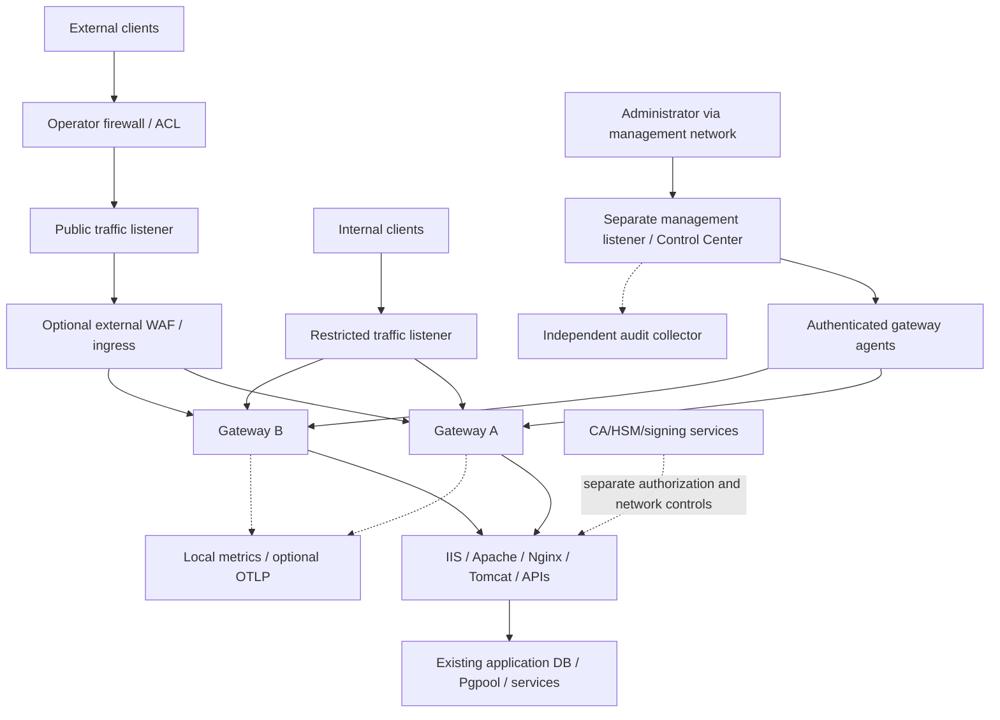
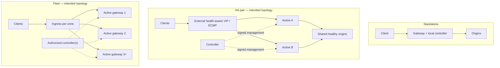
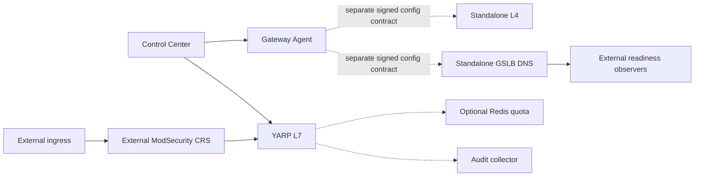

# 01 — System & deployment

Architectural context and responsibility boundaries.

[← Visual atlas](README.md) · [Authority visual atlas](https://github.com/VY-Groups/gatewaycore-license-authority/tree/docs/visual-authority-atlas/docs/diagrams)

> Source snapshot: `6c24dbbab53718102cd96c6380bbe15263a36fe9` (commercial development candidate, not a production release). Diagrams are logical views, not physical deployment instructions. Optional integrations must be explicitly provisioned. See the linked source and exact-head CI before treating any behavior as accepted.

## Logical network and trust zones

GatewayCore does not own the application database, firewall, HSM, or external VIP. Listener segregation is configured, not a replacement for network ACLs.

**Source at candidate:** [control-center/docs/ARCHITECTURE.md](https://github.com/VY-Groups/yarp-lb/blob/6c24dbbab53718102cd96c6380bbe15263a36fe9/control-center/docs/ARCHITECTURE.md) · [control-center/docs/WEB_SERVER_BACKENDS.md](https://github.com/VY-Groups/yarp-lb/blob/6c24dbbab53718102cd96c6380bbe15263a36fe9/control-center/docs/WEB_SERVER_BACKENDS.md) · [control-center/docs/EXTERNAL_INTEGRATION_ACCEPTANCE.md](https://github.com/VY-Groups/yarp-lb/blob/6c24dbbab53718102cd96c6380bbe15263a36fe9/control-center/docs/EXTERNAL_INTEGRATION_ACCEPTANCE.md)

## Deployment modes

All data-plane gateways are active peers; controller ownership is separate. The topology API stores design metadata only. A multi-controller desired-state database and physical ingress are not created by onboarding.

**Source at candidate:** [control-center/Onboarding.cs](https://github.com/VY-Groups/yarp-lb/blob/6c24dbbab53718102cd96c6380bbe15263a36fe9/control-center/Onboarding.cs) · [control-center/docs/V1_HA_SCOPE.md](https://github.com/VY-Groups/yarp-lb/blob/6c24dbbab53718102cd96c6380bbe15263a36fe9/control-center/docs/V1_HA_SCOPE.md)

## Component ownership

Separate binaries and optional integrations have distinct configuration, credentials and acceptance gates. This is not a single automatically installed appliance.

**Source at candidate:** [engines/L4/README.md](https://github.com/VY-Groups/yarp-lb/blob/6c24dbbab53718102cd96c6380bbe15263a36fe9/engines/L4/README.md) · [engines/GslbDns/README.md](https://github.com/VY-Groups/yarp-lb/blob/6c24dbbab53718102cd96c6380bbe15263a36fe9/engines/GslbDns/README.md) · [engines/GslbObserver/README.md](https://github.com/VY-Groups/yarp-lb/blob/6c24dbbab53718102cd96c6380bbe15263a36fe9/engines/GslbObserver/README.md) · [control-center/docs/ENGINE_GATES.md](https://github.com/VY-Groups/yarp-lb/blob/6c24dbbab53718102cd96c6380bbe15263a36fe9/control-center/docs/ENGINE_GATES.md)

