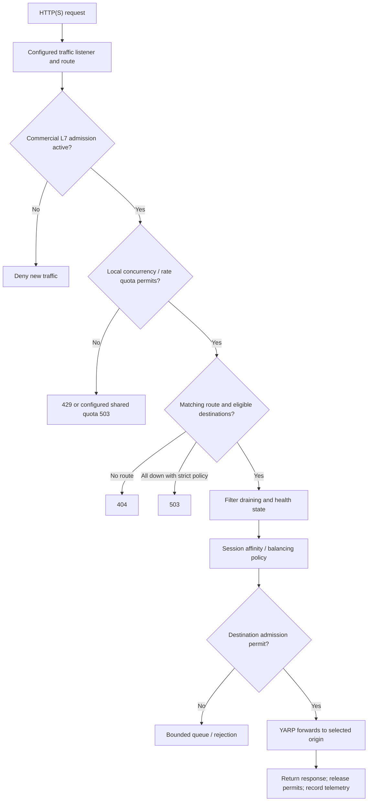
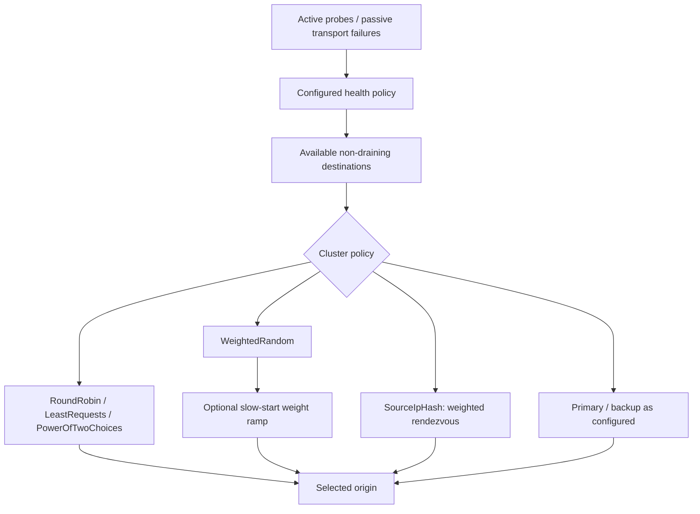
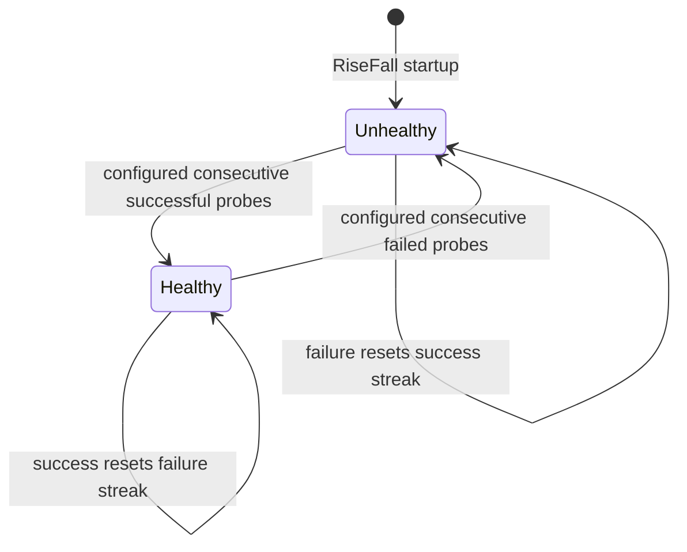
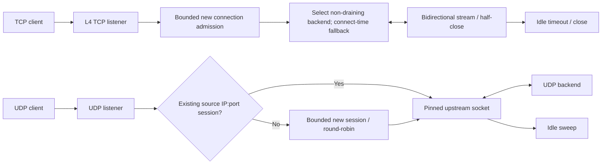
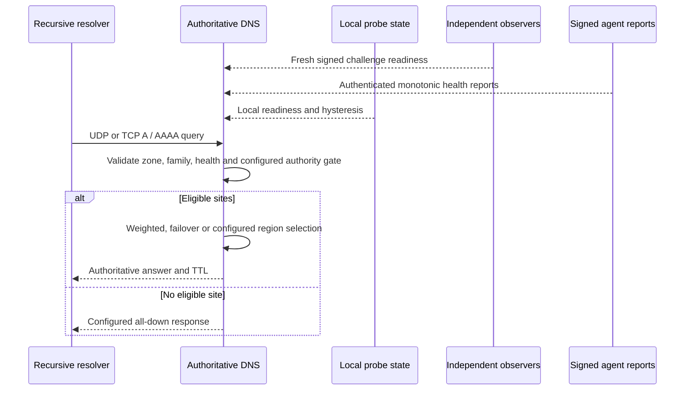
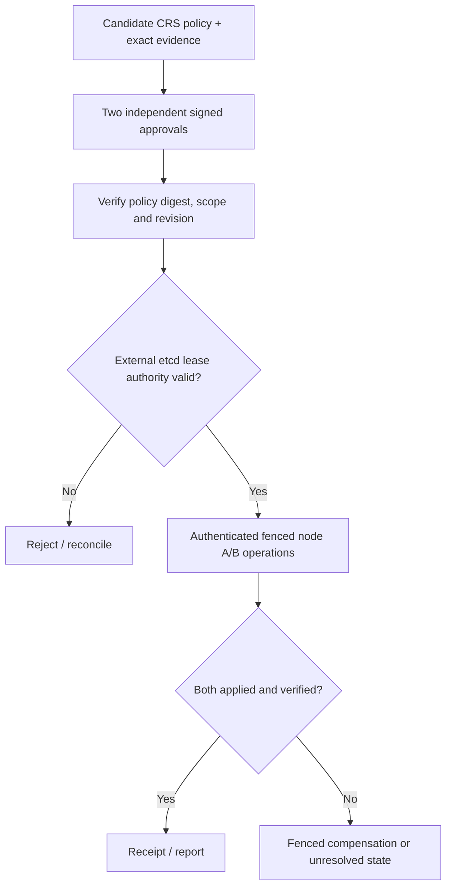
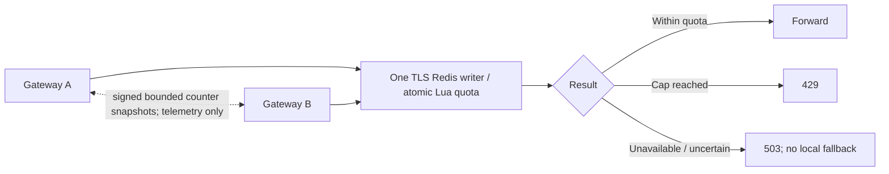

# 02 — Traffic & engines

Logical traffic decisions, distinct from the management workflow.

[← Visual atlas](README.md) · [Authority visual atlas](https://github.com/VY-Groups/gatewaycore-license-authority/tree/docs/visual-authority-atlas/docs/diagrams)

> Source snapshot: `6c24dbbab53718102cd96c6380bbe15263a36fe9` (commercial development candidate, not a production release). Diagrams are logical views, not physical deployment instructions. Optional integrations must be explicitly provisioned. See the linked source and exact-head CI before treating any behavior as accepted.

## L7 HTTP request lifecycle

Logical decision view; not an exact middleware order or universal HTTP status contract. No automatic replay of non-idempotent requests. Health/affinity settings affect eligible selection.

**Source at candidate:** [control-center/Program.cs](https://github.com/VY-Groups/yarp-lb/blob/6c24dbbab53718102cd96c6380bbe15263a36fe9/control-center/Program.cs) · [control-center/docs/L7_LIFECYCLE_OBSERVABILITY.md](https://github.com/VY-Groups/yarp-lb/blob/6c24dbbab53718102cd96c6380bbe15263a36fe9/control-center/docs/L7_LIFECYCLE_OBSERVABILITY.md) · [control-center/docs/PROXY_OVERLOAD_RECOVERY.md](https://github.com/VY-Groups/yarp-lb/blob/6c24dbbab53718102cd96c6380bbe15263a36fe9/control-center/docs/PROXY_OVERLOAD_RECOVERY.md)

## Load balancing and health

RiseFall is opt-in. Draining is a separate administrative condition; existing forwarded work is not automatically replayed.

**Source at candidate:** [control-center/docs/TRAFFIC_ENGINE.md](https://github.com/VY-Groups/yarp-lb/blob/6c24dbbab53718102cd96c6380bbe15263a36fe9/control-center/docs/TRAFFIC_ENGINE.md) · [control-center/docs/ACTIVE_HEALTH_RISE_FALL.md](https://github.com/VY-Groups/yarp-lb/blob/6c24dbbab53718102cd96c6380bbe15263a36fe9/control-center/docs/ACTIVE_HEALTH_RISE_FALL.md) · [control-center/docs/PRIMARY_BACKUP_ROUTING.md](https://github.com/VY-Groups/yarp-lb/blob/6c24dbbab53718102cd96c6380bbe15263a36fe9/control-center/docs/PRIMARY_BACKUP_ROUTING.md)

## L4 TCP and UDP

Independent process; no SNI/TLS termination or cross-process session replication assumed. Commercial entitlement loss can stop new and established forwarding in the candidate.

**Source at candidate:** [engines/L4/README.md](https://github.com/VY-Groups/yarp-lb/blob/6c24dbbab53718102cd96c6380bbe15263a36fe9/engines/L4/README.md) · [docs/OFFLINE_COMMERCIAL_LICENSING.md](https://github.com/VY-Groups/yarp-lb/blob/6c24dbbab53718102cd96c6380bbe15263a36fe9/docs/OFFLINE_COMMERCIAL_LICENSING.md)

## GSLB authoritative DNS and readiness

Observer/report authority modes are opt-in. DNSSEC and actual public delegation, resolver cache convergence and real regional network validation are separate acceptance requirements.

**Source at candidate:** [engines/GslbDns/README.md](https://github.com/VY-Groups/yarp-lb/blob/6c24dbbab53718102cd96c6380bbe15263a36fe9/engines/GslbDns/README.md) · [engines/GslbObserver/README.md](https://github.com/VY-Groups/yarp-lb/blob/6c24dbbab53718102cd96c6380bbe15263a36fe9/engines/GslbObserver/README.md) · [engines/GslbDns/AuthorityFence.cs](https://github.com/VY-Groups/yarp-lb/blob/6c24dbbab53718102cd96c6380bbe15263a36fe9/engines/GslbDns/AuthorityFence.cs)

## External WAF policy rollout

The WAF lease contract is **not** the persistent commercial L7 fleet lock. Policy acceptance is not proof of false-positive rates, real traffic or production performance.

**Source at candidate:** [ops/waf/SIGNED_POLICY_ACCEPTANCE.md](https://github.com/VY-Groups/yarp-lb/blob/6c24dbbab53718102cd96c6380bbe15263a36fe9/ops/waf/SIGNED_POLICY_ACCEPTANCE.md) · [ops/waf/ETCD_QUORUM_FENCING.md](https://github.com/VY-Groups/yarp-lb/blob/6c24dbbab53718102cd96c6380bbe15263a36fe9/ops/waf/ETCD_QUORUM_FENCING.md) · [ops/waf/REMOTE_FENCED_NODE.md](https://github.com/VY-Groups/yarp-lb/blob/6c24dbbab53718102cd96c6380bbe15263a36fe9/ops/waf/REMOTE_FENCED_NODE.md)

## Optional shared quota and telemetry

The Redis experiment is not a v1 HA dependency, distributed session store, or safe automatic replica promotion solution.

**Source at candidate:** [control-center/docs/SHARED_RATE_QUOTA_EXPERIMENT.md](https://github.com/VY-Groups/yarp-lb/blob/6c24dbbab53718102cd96c6380bbe15263a36fe9/control-center/docs/SHARED_RATE_QUOTA_EXPERIMENT.md) · [control-center/docs/PEER_COUNTER_SYNC.md](https://github.com/VY-Groups/yarp-lb/blob/6c24dbbab53718102cd96c6380bbe15263a36fe9/control-center/docs/PEER_COUNTER_SYNC.md)

