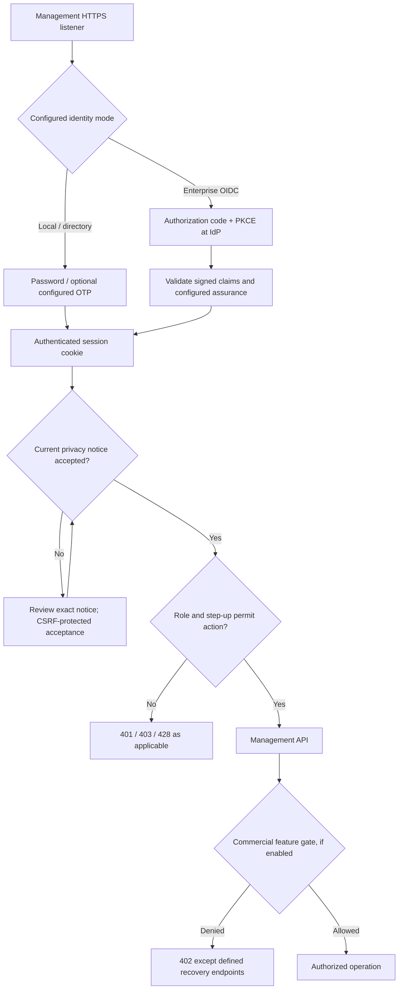
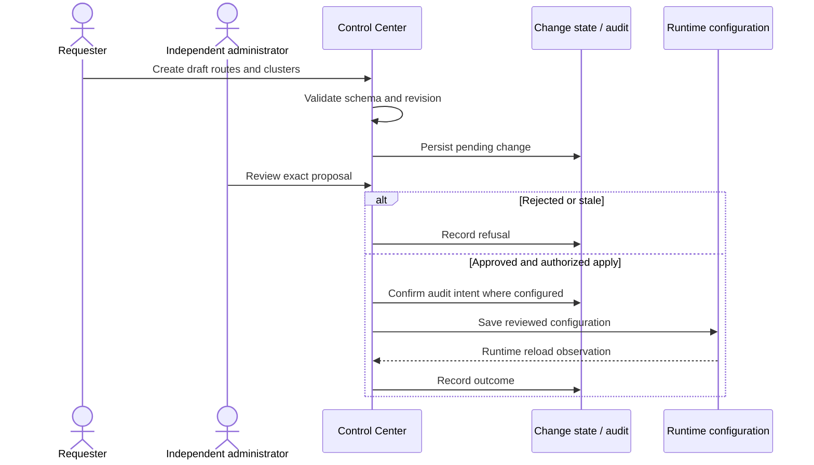
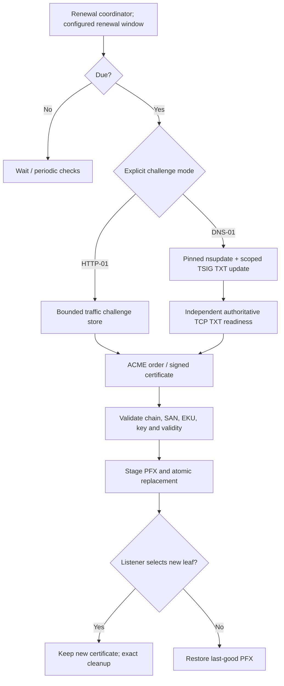
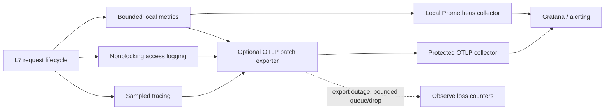

# 03 — Control Center & security

Identity, approval, configuration, certificates and observability.

[← Visual atlas](README.md) · [Authority visual atlas](https://github.com/VY-Groups/gatewaycore-license-authority/tree/docs/visual-authority-atlas/docs/diagrams)

> Source snapshot: `6c24dbbab53718102cd96c6380bbe15263a36fe9` (commercial development candidate, not a production release). Diagrams are logical views, not physical deployment instructions. Optional integrations must be explicitly provisioned. See the linked source and exact-head CI before treating any behavior as accepted.

## Sign-in and administrative access


Logical gates rather than literal middleware order. Viewer cannot perform ordinary mutations; approved recovery exceptions are deliberately narrow. IdP owns passkey verification. Notice acknowledgement is not a legal compliance certification.

**Source at candidate:** [control-center/Program.cs](https://github.com/VY-Groups/yarp-lb/blob/6c24dbbab53718102cd96c6380bbe15263a36fe9/control-center/Program.cs) · [control-center/ManagementPrivacyPolicy.cs](https://github.com/VY-Groups/yarp-lb/blob/6c24dbbab53718102cd96c6380bbe15263a36fe9/control-center/ManagementPrivacyPolicy.cs) · [control-center/docs/ENTERPRISE_OIDC.md](https://github.com/VY-Groups/yarp-lb/blob/6c24dbbab53718102cd96c6380bbe15263a36fe9/control-center/docs/ENTERPRISE_OIDC.md)

## Reviewed configuration


For remote fleet changes use the separate [quorum sequence](05-fencing.md); local change approval is not proof of every remote activation or application health.

**Source at candidate:** [control-center/Program.cs](https://github.com/VY-Groups/yarp-lb/blob/6c24dbbab53718102cd96c6380bbe15263a36fe9/control-center/Program.cs) · [control-center/docs/API_CONTRACT.md](https://github.com/VY-Groups/yarp-lb/blob/6c24dbbab53718102cd96c6380bbe15263a36fe9/control-center/docs/API_CONTRACT.md)

## External audit
```mermaid
sequenceDiagram
participant G as Gateway
participant C as Independent audit collector
participant L as Append-only signed ledger
participant W as Optional object-lock store
G->>C: HTTPS intent + node HMAC + exact state digests
C->>C: Validate identity, time, schema and replay
C->>L: Append and flush signed entry
opt Configured independent retention
  C->>W: Conditional object put and verify exact retention
end
C-->>G: RSA-PSS signed receipt
alt Receipt valid
  G->>G: Recheck plan and perform mutation
else Missing or invalid
  G->>G: Fail closed; no mutation
end
```

The receipt proves the accepted intent, not application of the later write. Retention enforcement and external provider trust require operational verification.

**Source at candidate:** [engines/AuditCollector/README.md](https://github.com/VY-Groups/yarp-lb/blob/6c24dbbab53718102cd96c6380bbe15263a36fe9/engines/AuditCollector/README.md) · [control-center/docs/EXTERNAL_AUDIT_INTENT.md](https://github.com/VY-Groups/yarp-lb/blob/6c24dbbab53718102cd96c6380bbe15263a36fe9/control-center/docs/EXTERNAL_AUDIT_INTENT.md)

## TLS and ACME


Both are explicitly configured opt-in paths; external CA/domain/TSIG interoperability, multi-node issuance and custody require real acceptance.

**Source at candidate:** [control-center/docs/ACME_IMPLEMENTATION_STATUS.md](https://github.com/VY-Groups/yarp-lb/blob/6c24dbbab53718102cd96c6380bbe15263a36fe9/control-center/docs/ACME_IMPLEMENTATION_STATUS.md) · [control-center/AcmeRenewal.cs](https://github.com/VY-Groups/yarp-lb/blob/6c24dbbab53718102cd96c6380bbe15263a36fe9/control-center/AcmeRenewal.cs)

## Observability


Metrics are not approval records; no telemetry dependency on the per-request license path. External monitoring and alert delivery need deployment acceptance.

**Source at candidate:** [control-center/docs/OTEL_EXPORT.md](https://github.com/VY-Groups/yarp-lb/blob/6c24dbbab53718102cd96c6380bbe15263a36fe9/control-center/docs/OTEL_EXPORT.md) · [control-center/docs/NONBLOCKING_LOGGING.md](https://github.com/VY-Groups/yarp-lb/blob/6c24dbbab53718102cd96c6380bbe15263a36fe9/control-center/docs/NONBLOCKING_LOGGING.md)

