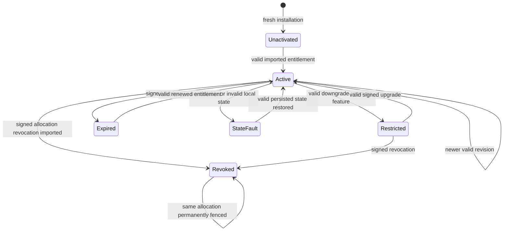
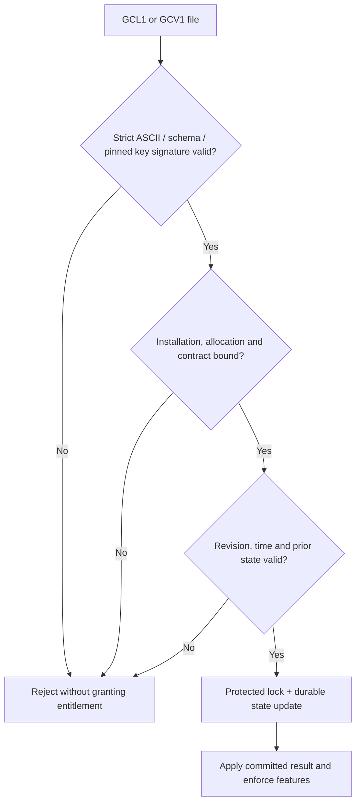
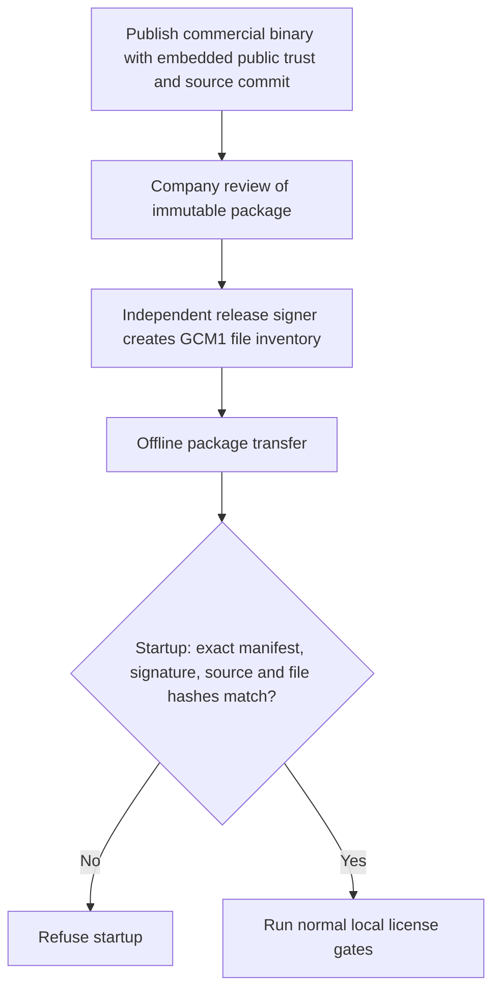

# 04 — Offline licensing & runtime

Candidate commercial profile; normal development builds do not enforce the commercial profile.

[← Visual atlas](README.md) · Authority visual atlas — `gatewaycore-license-authority:docs/diagrams/README.md`

> Source snapshot: `6c24dbbab53718102cd96c6380bbe15263a36fe9` (commercial development candidate, not a production release). Diagrams are logical views, not physical deployment instructions. Optional integrations must be explicitly provisioned. See the linked source and exact-head CI before treating any behavior as accepted.

## Offline exchange
```mermaid
sequenceDiagram
actor U as Customer administrator
participant G as Local commercial GatewayCore
participant O as Company authority operator
participant I as Isolated issuer
U->>G: Provision installation identity
G->>G: Generate P-256 installation key; protect local state
G-->>U: GCR1 signed activation request
U->>O: Transfer request offline
O->>O: Subscription, settlement, independent approval
O->>I: Approved database job
I-->>O: GCL1 signed site-bound allocation
O-->>U: Transfer signed license file offline
U->>G: Import signed license
G->>G: Pinned issuer public key, binding, revision, clock, expiry
G-->>U: License status / entitled features
```

No customer network call to the issuer. Key custody stays with the company; local private installation key stays with its installation.

**Source at candidate:** `src/GatewayCore.Licensing/OfflineLicenseStore.cs` (source 6c24dbb) · `control-center/CommercialLicenseRuntime.cs` (source 6c24dbb)

## Validation and runtime state


This is a logical state view, not a promise of identical policies for every engine. Candidate L7 admits no new requests after explicit downgrade/revocation/expiry; limited continuity for an unexpected state fault is bounded by monotonic and signed expiry. L4 entitlement loss stops forwarding including established sessions. Recovery-only agent operations remain narrowly authenticated. Whole-VM clone/rollback by privileged operators cannot be categorically prevented by software-only offline licensing.

**Source at candidate:** `control-center/CommercialLicenseRuntime.cs` (source 6c24dbb) · `src/CommercialEngine/EngineLicenseGate.cs` (source 6c24dbb) · `docs/OFFLINE_COMMERCIAL_LICENSING.md` (source 6c24dbb)

## Import decision



**Source at candidate:** `src/GatewayCore.Licensing/OfflineLicenseVerifier.cs` (source 6c24dbb) · `src/GatewayCore.Licensing/OfflineLicenseStore.cs` (source 6c24dbb)

## Release package integrity


Separate release-signing and entitlement keys. Integrity is enforced by the genuine commercial release profile; OS execution trust and key custody remain operator gates.

**Source at candidate:** `src/GatewayCore.Licensing/ReleaseIntegrityVerifier.cs` (source 6c24dbb) · `control-center/CommercialReleaseIntegrity.cs` (source 6c24dbb) · `control-center/GatewayCoreYarp.csproj` (source 6c24dbb)

