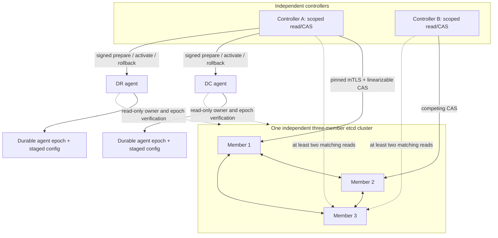
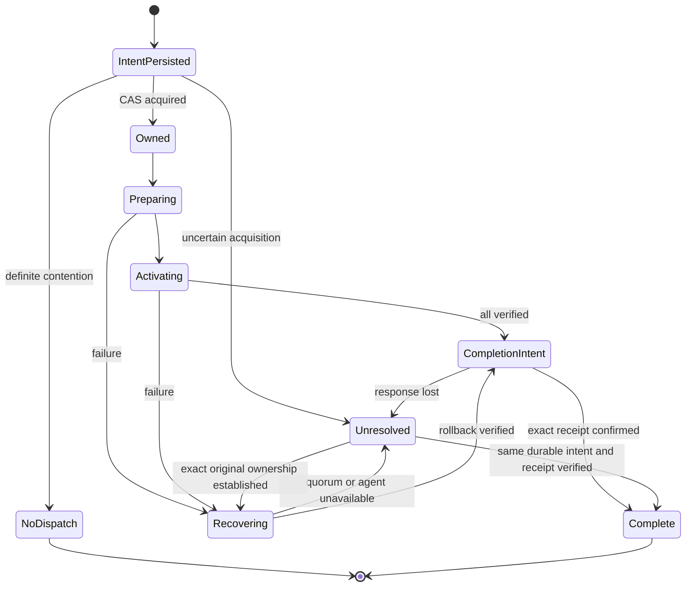
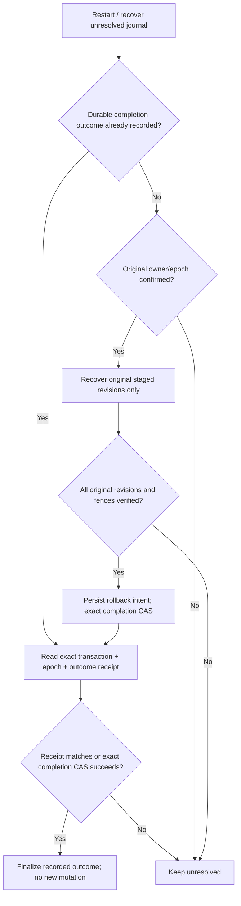

# 05 — Distributed controller fencing

Candidate PR #549: persistent per-deployment Raft ownership for **L7 fleet configuration**. This does not coordinate every engine, the data plane, external VIP, or offline installation clones.

[← Visual atlas](README.md) · [Authority visual atlas](https://github.com/VY-Groups/gatewaycore-license-authority/tree/docs/visual-authority-atlas/docs/diagrams)

> Source snapshot: `6c24dbbab53718102cd96c6380bbe15263a36fe9` (commercial development candidate, not a production release). Diagrams are logical views, not physical deployment instructions. Optional integrations must be explicitly provisioned. See the linked source and exact-head CI before treating any behavior as accepted.

## Controller/agent trust boundary


The scope is the SHA-256 of signed license ID, customer ID and deployment ID (newline-delimited). Key is persistent, not TTL-based. Raft modification revision is the signed fleet epoch. Reader and writer credentials must be separately scoped; the same cluster identity and distinct member certificate pins are provisioned on all participants.

**Source at candidate:** [control-center/FleetQuorum.cs](https://github.com/VY-Groups/yarp-lb/blob/6c24dbbab53718102cd96c6380bbe15263a36fe9/control-center/FleetQuorum.cs) · [control-center/GatewayAgent/Program.cs](https://github.com/VY-Groups/yarp-lb/blob/6c24dbbab53718102cd96c6380bbe15263a36fe9/control-center/GatewayAgent/Program.cs)

## Normal rollout sequence
```mermaid
sequenceDiagram
actor A as Requester
actor B as Independent reviewer
participant C as Controller
participant Q as etcd majority
participant D as DC agent
participant R as DR agent
A->>C: Submit change
B->>C: Approve exact change
C->>D: GCP1 nonce proof + status
D-->>C: Signed installation proof, revision, high-water
C->>R: GCP1 nonce proof + status
R-->>C: Signed installation proof, revision, high-water
C->>C: Validate unique installations, sites, limits, audit intent
C->>Q: CAS create persistent transaction lock
Q-->>C: Global epoch above agent high-water
loop Each prepare and activation boundary
  C->>D: Fresh entitlement challenge
  C->>R: Fresh entitlement challenge
  C->>Q: Confirm exact owner and epoch
  C->>D: Signed prepare or activate (target example)
  D->>Q: Independent linearizable quorum proof
  D-->>C: Verified revision acknowledgement
  Note over C,R: Repeat for each target; persist journal
end
C->>C: Final peer proof and durable completion intent
C->>Q: CAS exact owner and epoch; write completion receipt and delete lock
Q-->>C: Confirm exact immutable receipt
C-->>A: Activated, pending application health validation
```


**Source at candidate:** [control-center/Program.cs](https://github.com/VY-Groups/yarp-lb/blob/6c24dbbab53718102cd96c6380bbe15263a36fe9/control-center/Program.cs) · [control-center/FleetRolloutJournal.cs](https://github.com/VY-Groups/yarp-lb/blob/6c24dbbab53718102cd96c6380bbe15263a36fe9/control-center/FleetRolloutJournal.cs) · [control-center/FleetQuorum.cs](https://github.com/VY-Groups/yarp-lb/blob/6c24dbbab53718102cd96c6380bbe15263a36fe9/control-center/FleetQuorum.cs)

## Competing controllers and partition
```mermaid
sequenceDiagram
participant A as Controller A
participant B as Controller B
participant Q as etcd
participant N as Agent
par Concurrent acquisition
 A->>Q: CAS absent key -> transaction A
and
 B->>Q: CAS absent key -> transaction B
end
Q-->>A: One owner (example A)
Q-->>B: Definite conflict; no dispatch
A->>N: Signed prepare with epoch
N->>Q: Verify live owner
Q-->>N: Consistent majority
N-->>A: Prepared
Note over Q,N: Two members unavailable
A->>Q: Fresh quorum check
Q-->>A: No majority
N->>Q: Verify before activation
Q-->>N: No majority
N-->>A: Reject configuration mutation
Note over A,N: Persistent lock remains; healthy local traffic is a separate concern
```

Definite competing acquisition does not leave a blocking local mutation; an uncertain CAS preserves unresolved state. No automatic timeout or minority takeover.

**Source at candidate:** [control-center/FleetQuorum.cs](https://github.com/VY-Groups/yarp-lb/blob/6c24dbbab53718102cd96c6380bbe15263a36fe9/control-center/FleetQuorum.cs) · [tests/WafEtcd/commercial_fleet_quorum.py](https://github.com/VY-Groups/yarp-lb/blob/6c24dbbab53718102cd96c6380bbe15263a36fe9/tests/WafEtcd/commercial_fleet_quorum.py)

## Recovery and completion state




Recovery does not relicense revoked installations. Late activation is rejected by local durable fence, sequence and entitlement checks. Do not manually delete a stuck Raft key or restore an old snapshot without independent reconciliation. The lock deliberately trades automatic takeover for safety.

**Source at candidate:** [control-center/FleetRolloutJournal.cs](https://github.com/VY-Groups/yarp-lb/blob/6c24dbbab53718102cd96c6380bbe15263a36fe9/control-center/FleetRolloutJournal.cs) · [control-center/GatewayAgent/Program.cs](https://github.com/VY-Groups/yarp-lb/blob/6c24dbbab53718102cd96c6380bbe15263a36fe9/control-center/GatewayAgent/Program.cs) · [control-center/tests/EngineConfigSecurityTests/agent_crl_acceptance.py](https://github.com/VY-Groups/yarp-lb/blob/6c24dbbab53718102cd96c6380bbe15263a36fe9/control-center/tests/EngineConfigSecurityTests/agent_crl_acceptance.py)

## Distinct distributed contracts
| Contract | Authority | Scope |
|---|---|---|
| Commercial L7 fleet | Persistent etcd lock + immutable completion receipt | One signed deployment / transaction |
| WAF deployment | Independent bounded etcd lease verifier / CAS writer | WAF policy transaction |
| Linux Data Protection | Separate scoped runtime writer lease and encrypted key ring | Key-ring writes |
| GSLB health | Configured health evidence and authority fence contracts | DNS health/answer eligibility |
| Redis quota | Single TLS Redis writer | Atomic per-peer quota pilot |

Do not substitute one contract for another. Physical quorum placement, RBAC, backup reconciliation and end-to-end availability remain acceptance gates.
