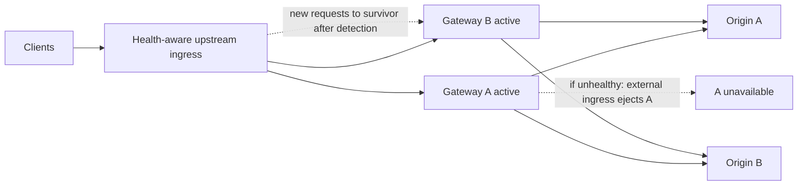
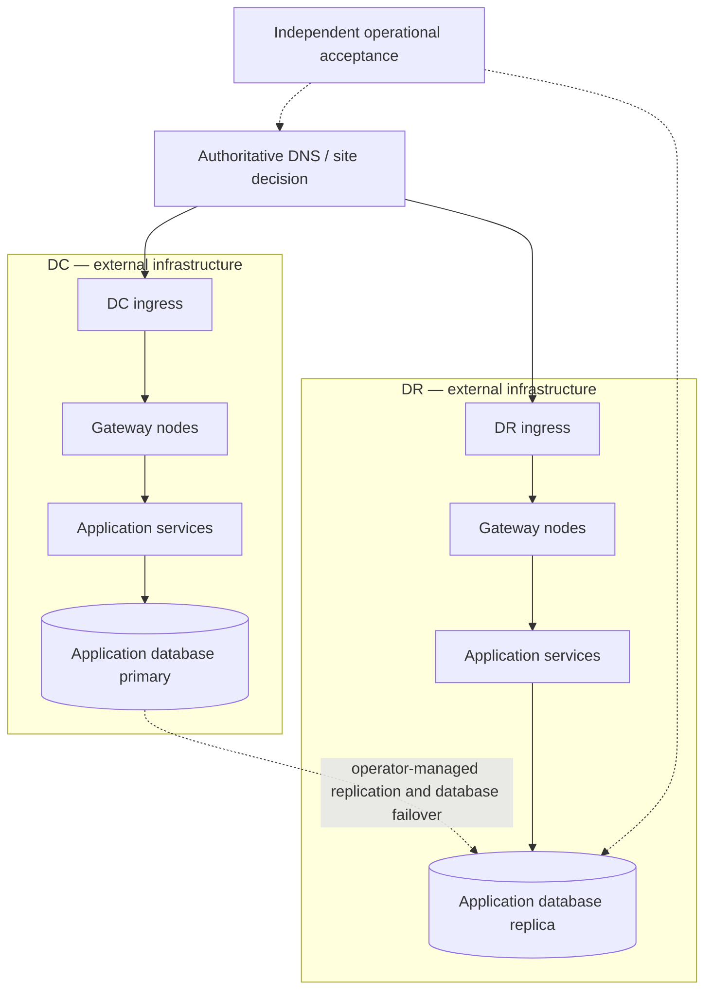
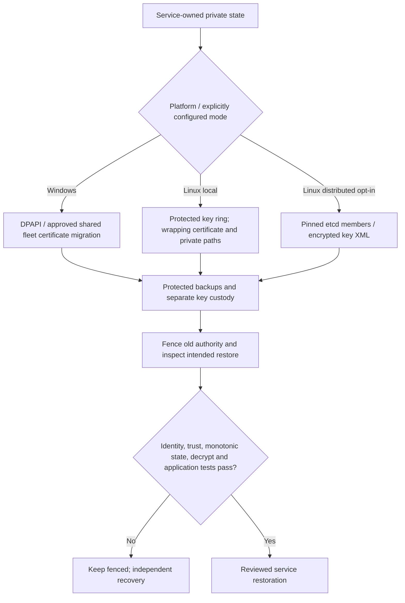
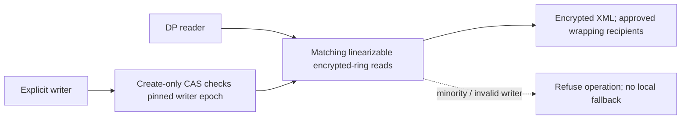
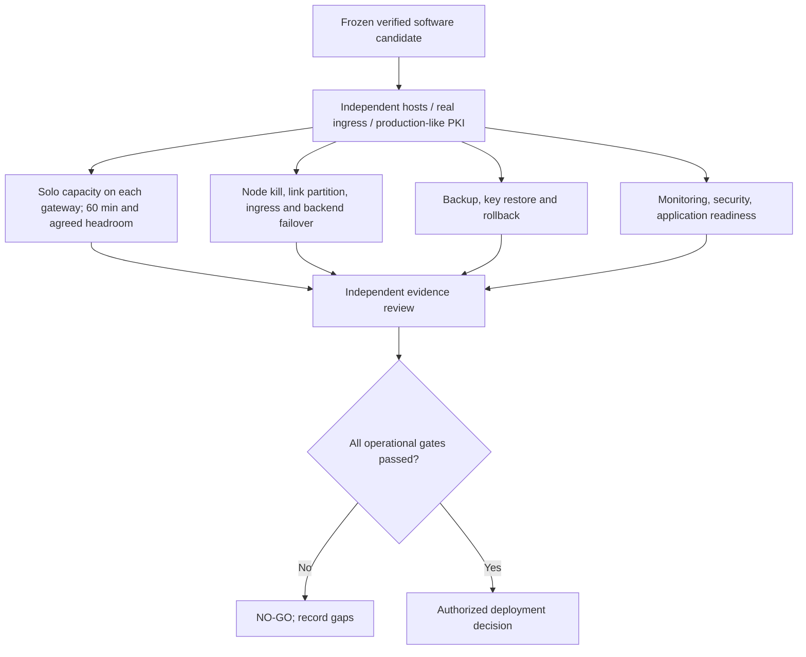

# 06 — HA, DR & key protection

Operator-managed failover and recovery boundaries. No physical readiness claim.

[← Visual atlas](README.md) · [Authority visual atlas](https://github.com/VY-Groups/gatewaycore-license-authority/tree/docs/visual-authority-atlas/docs/diagrams)

> Source snapshot: `6c24dbbab53718102cd96c6380bbe15263a36fe9` (commercial development candidate, not a production release). Diagrams are logical views, not physical deployment instructions. Optional integrations must be explicitly provisioned. See the linked source and exact-head CI before treating any behavior as accepted.

## Active-active traffic and node failure

Real independent-host VIP/ECMP, ingress redundancy and application idempotence are external acceptance. Existing connections may fail; no automatic replay of non-idempotent calls.

**Source at candidate:** [control-center/docs/V1_HA_SCOPE.md](https://github.com/VY-Groups/yarp-lb/blob/6c24dbbab53718102cd96c6380bbe15263a36fe9/control-center/docs/V1_HA_SCOPE.md) · [control-center/docs/FAILOVER_POLICY.md](https://github.com/VY-Groups/yarp-lb/blob/6c24dbbab53718102cd96c6380bbe15263a36fe9/control-center/docs/FAILOVER_POLICY.md)

## DC/DR design

Logical reference only. GatewayCore does not promote or reconcile application databases. Validate DNS cache convergence, application readiness and replication independently.

**Source at candidate:** [control-center/docs/ARCHITECTURE.md](https://github.com/VY-Groups/yarp-lb/blob/6c24dbbab53718102cd96c6380bbe15263a36fe9/control-center/docs/ARCHITECTURE.md) · [engines/GslbDns/README.md](https://github.com/VY-Groups/yarp-lb/blob/6c24dbbab53718102cd96c6380bbe15263a36fe9/engines/GslbDns/README.md)

## Protected key and state recovery

This is separate from commercial installation key protection and L7 fleet fencing. Neither filesystem backups nor logical test recovery prove whole-snapshot anti-rollback or site RPO/RTO.

**Source at candidate:** [control-center/docs/DATA_PROTECTION_PLATFORM_SUPPORT.md](https://github.com/VY-Groups/yarp-lb/blob/6c24dbbab53718102cd96c6380bbe15263a36fe9/control-center/docs/DATA_PROTECTION_PLATFORM_SUPPORT.md) · [ops/fleet/LINUX_DP_DISTRIBUTED_RUNTIME.md](https://github.com/VY-Groups/yarp-lb/blob/6c24dbbab53718102cd96c6380bbe15263a36fe9/ops/fleet/LINUX_DP_DISTRIBUTED_RUNTIME.md) · [ops/fleet/LINUX_DP_QUORUM_AUTHORITY.md](https://github.com/VY-Groups/yarp-lb/blob/6c24dbbab53718102cd96c6380bbe15263a36fe9/ops/fleet/LINUX_DP_QUORUM_AUTHORITY.md)

## Physical acceptance

See [issue #36](https://github.com/VY-Groups/yarp-lb/issues/36) and official acceptance runbooks. No physical tests were performed by creating these diagrams.

**Source at candidate:** [ops/release/README.md](https://github.com/VY-Groups/yarp-lb/blob/6c24dbbab53718102cd96c6380bbe15263a36fe9/ops/release/README.md) · [control-center/docs/ONPREM_PRODUCTION_GO_GATES.md](https://github.com/VY-Groups/yarp-lb/blob/6c24dbbab53718102cd96c6380bbe15263a36fe9/control-center/docs/ONPREM_PRODUCTION_GO_GATES.md)

