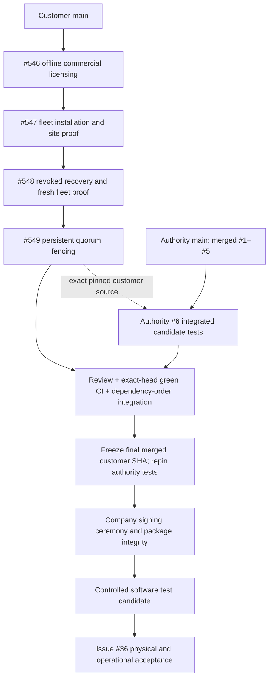
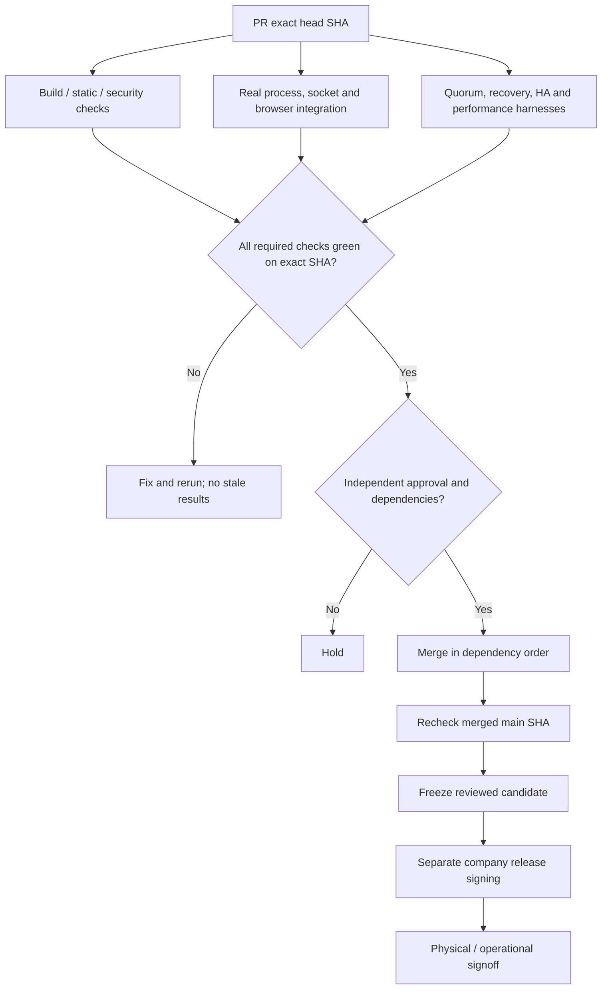

# 07 — Build, test & release

Source to acceptance. No automatic production deployment.

[← Visual atlas](README.md) · Authority visual atlas — `gatewaycore-license-authority:docs/diagrams/README.md`

> Source snapshot: `6c24dbbab53718102cd96c6380bbe15263a36fe9` (commercial development candidate, not a production release). Diagrams are logical views, not physical deployment instructions. Optional integrations must be explicitly provisioned. See the linked source and exact-head CI before treating any behavior as accepted.

## Customer licensing stack and authority integration

This is a dependency map, not live PR status. Check PRs and CI links before merging or releasing. Historical public-source licensing obligations and owner-approved commercial terms remain separate.

**Source at candidate:** `docs/OFFLINE_COMMERCIAL_LICENSING.md` (source 6c24dbb) · `ops/release/README.md` (source 6c24dbb)

## CI gate and release

Individual job graphs are in the [CI catalog](08-ci-index.md). The catalog is source-derived; green run status is not inferred.

**Source at candidate:** `docs/CI_SCOPE.md` (source 6c24dbb) · `control-center/docs/RELEASE_GATES.md` (source 6c24dbb) · `ops/release/README.md` (source 6c24dbb)

