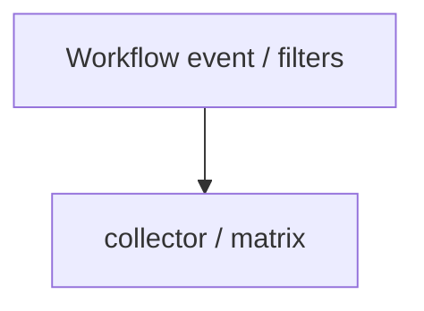
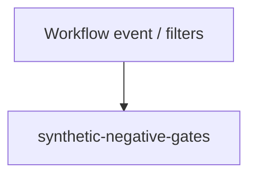
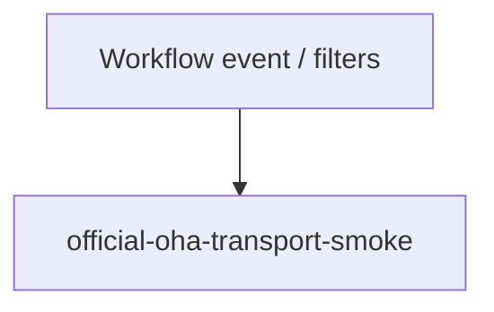
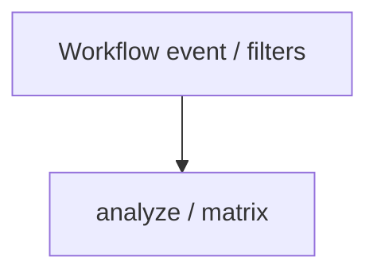
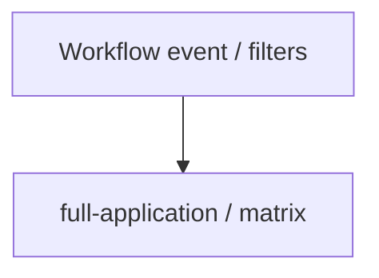
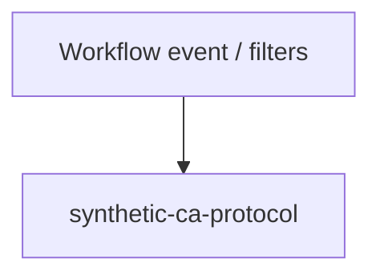
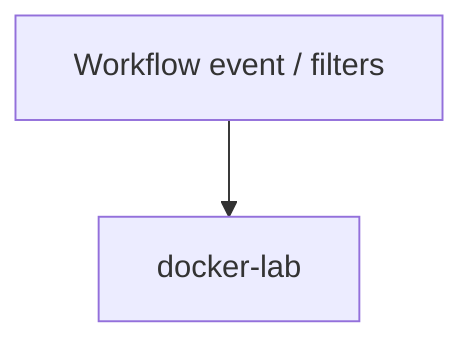
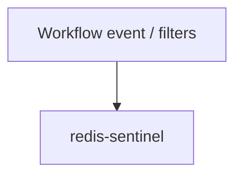
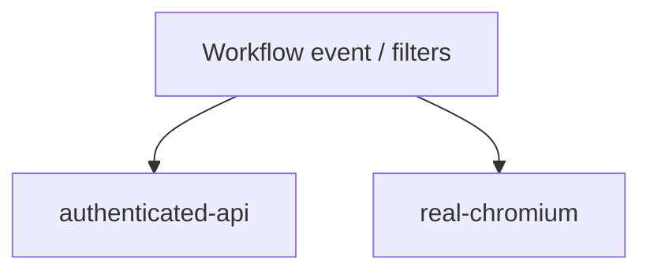
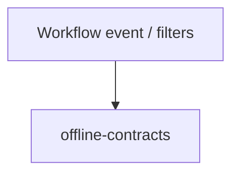

# CI workflow catalog — group 1

[← Catalog index](08-ci-index.md) · [Visual atlas](README.md)

Pinned candidate source: `6c24dbbab53718102cd96c6380bbe15263a36fe9`. This is a source-derived job DAG and ordered step summary, **not** run status. Trigger branch/path filters, job/step conditions, matrix combinations, permissions, reusable workflows and actual commands remain defined by the linked YAML. Parallel arrows mean no declared job dependency, not guaranteed concurrent runner availability.

## audit-collector-ci.yml

**Independent audit collector HTTPS acceptance** — [exact workflow YAML](https://github.com/VY-Groups/yarp-lb/blob/6c24dbbab53718102cd96c6380bbe15263a36fe9/.github/workflows/audit-collector-ci.yml)

Events: push, pull_request, workflow_dispatch.

- **collector** — ${{ matrix.os }} (matrix). 1. Use actions/checkout@v4 → 2. Use actions/setup-dotnet@v4 → 3. Run dotnet build → 4. Verify durable retention journal and SDK contract → 5. Build shipping gateway for real receipt acceptance → 6. Use actions/setup-python@v5 → 7. Install pinned disposable STARTTLS fixture → 8. Real TLS receiver, signed chain, restart, replay and administrative receipts

## capacity-contract.yml

**v0.1 capacity strict measured input contracts** — [exact workflow YAML](https://github.com/VY-Groups/yarp-lb/blob/6c24dbbab53718102cd96c6380bbe15263a36fe9/.github/workflows/capacity-contract.yml)

Events: pull_request, workflow_dispatch.

- **synthetic-negative-gates** — ubuntu-24.04 . 1. Use actions/checkout@v4 → 2. Compile fail-closed Python contracts → 3. Execute complete-hour fixture and negative gate tests → 4. Refuse to approve unpopulated production example

## capacity-oha-smoke.yml

**v0.1 real oha JSON and fixed-body smoke (CI only)** — [exact workflow YAML](https://github.com/VY-Groups/yarp-lb/blob/6c24dbbab53718102cd96c6380bbe15263a36fe9/.github/workflows/capacity-oha-smoke.yml)

Events: pull_request, workflow_dispatch.

- **official-oha-transport-smoke** — ubuntu-24.04 . 1. Use actions/checkout@v4 → 2. Start a disposable fixed-size loopback test backend → 3. Exercise verified oha executable JSON, ALPN and exact-size bodies → 4. Upload actual raw generator JSON and CI version evidence

## codeql.yml

**CodeQL Advanced** — [exact workflow YAML](https://github.com/VY-Groups/yarp-lb/blob/6c24dbbab53718102cd96c6380bbe15263a36fe9/.github/workflows/codeql.yml)

Events: push, pull_request, schedule.

- **analyze** — ${{ (matrix.language == 'swift' && 'macos-latest') // 'ubuntu-latest' }} (matrix). See YAML for steps/reusable call.

## control-center-ci.yml

**Control Center 0.1 - complete application source checks** — [exact workflow YAML](https://github.com/VY-Groups/yarp-lb/blob/6c24dbbab53718102cd96c6380bbe15263a36fe9/.github/workflows/control-center-ci.yml)

Events: push, pull_request, workflow_dispatch.

- **full-application** — ${{ matrix.os }} (matrix). 1. Use actions/checkout@v4 → 2. Use actions/setup-dotnet@v4 → 3. Use actions/setup-node@v4 → 4. Build complete ASP.NET Core control plane → 5. Build separate gateway agent → 6. Test read-only GitOps route and cluster plan → 7. Run load balancing core tests → 8. Verify actual Control Center console cannot block gateway request threads → 9. Verify signed fleet configuration acceptance → 10. Verify signed independent engine config contracts → 11. Test backend mTLS certificate contract → 12. Verify Linux production Data Protection RSA encryption and rotation → 13. Real two-process Linux fleet key rotation and lost-key recovery → 14. Reject unsafe legacy-state cutover without modifying users or keys → 15. Verify real Control Center EC2 CI-only TLS safety and allowlist → 16. Offline functional smoke of the real Control Center and two local backends → 17. Real HTTPS peer v4 delta, gap recovery and receiver restart → 18. Verify EC2 request caps and read-only harness without network access → 19. Install Microsoft MsQuic for mandatory Linux HTTP/3 acceptance → 20. Test TLS inventory and exact HTTP/2 and HTTP/3 gRPC transport → 21. Check frontend compile reproducibility → 22. Run frontend UI regression tests → 23. Verify repository-wide neutral branding and build target paths → 24. Run backend source contract checks

## docker-0.1-ca.yml

**v0.1 synthetic OCSP CRL contract** — [exact workflow YAML](https://github.com/VY-Groups/yarp-lb/blob/6c24dbbab53718102cd96c6380bbe15263a36fe9/.github/workflows/docker-0.1-ca.yml)

Events: pull_request, workflow_dispatch.

- **synthetic-ca-protocol** — ubuntu-24.04 . 1. Use actions/checkout@v4 → 2. Create synthetic CA, verify good/revoked OCSP and signed DER CRL → 3. Use actions/upload-artifact@v4

## docker-0.1-integration.yml

**v0.1 disposable Docker integration (real Control Center)** — [exact workflow YAML](https://github.com/VY-Groups/yarp-lb/blob/6c24dbbab53718102cd96c6380bbe15263a36fe9/.github/workflows/docker-0.1-integration.yml)

Events: pull_request, workflow_dispatch.

- **docker-lab** — ubuntu-24.04 . 1. Use actions/checkout@v4 → 2. Docker availability → 3. Generate disposable trust-verified P-256 ingress identity → 4. Validate compose graph → 5. Build and boot two shipping YARP instances, two ingress, two backends, two local Prometheus → 6. Capture deterministic host, ingress and gateway endpoint diagnostics → 7. Real HTTP, real HTTPS with chain trust, RBAC boundary, no-replay, metrics and collector → 8. Verify CI Grafana provisioned dashboards and two datasources → 9. Kill a gateway, keep both ingress endpoints available → 10. Require full gateway reintegration before the separate ingress fault → 11. Kill one ingress, continue through independent second ingress container → 12. Rotate P-256 leaf and reload both ingress containers → 13. Fail-closed invalid Linux X509 certificate file → 14. Capture evidence and tear down CI resources → 15. Use actions/upload-artifact@v4

## docker-0.1-redis.yml

**v0.1 Docker Redis TLS Sentinel prototype** — [exact workflow YAML](https://github.com/VY-Groups/yarp-lb/blob/6c24dbbab53718102cd96c6380bbe15263a36fe9/.github/workflows/docker-0.1-redis.yml)

Events: pull_request, workflow_dispatch.

- **redis-sentinel** — ubuntu-24.04 . 1. Use actions/checkout@v4 → 2. Generate disposable CA and multi-SAN TLS server certificate → 3. Validate Compose, TLS Redis primary/replica and 3 Sentinel containers → 4. Validate TLS/auth/ACL, CAS, failover and retained configuration → 5. Collect failure evidence and destroy all disposable secrets and containers → 6. Use actions/upload-artifact@v4

## e2e-real-control-center.yml

**Real Control Center E2E - browser and API** — [exact workflow YAML](https://github.com/VY-Groups/yarp-lb/blob/6c24dbbab53718102cd96c6380bbe15263a36fe9/.github/workflows/e2e-real-control-center.yml)

Events: pull_request, push, workflow_dispatch.

- **authenticated-api** — ubuntu-24.04 . 1. Use actions/checkout@v4 → 2. Use actions/setup-dotnet@v4 → 3. Use actions/setup-python@v5 → 4. Build shipping production-mode Control Center → 5. Execute REAL HTTP backend flow against isolated local .NET process
- **real-chromium** — ubuntu-24.04 . 1. Use actions/checkout@v4 → 2. Use actions/setup-dotnet@v4 → 3. Use actions/setup-node@v4 → 4. Use actions/setup-python@v5 → 5. Build shipping production-mode Control Center → 6. Install pinned Playwright test package → 7. Install Chromium OS dependencies without interrupting dpkg → 8. Install pinned Chromium browser → 9. Browser acceptance on real localhost GatewayCore Kestrel → 10. Keep screenshots, traces and browser reports for failures

## ec2-gate-contracts.yml

**EC2 optional-backend prerequisite gate contracts** — [exact workflow YAML](https://github.com/VY-Groups/yarp-lb/blob/6c24dbbab53718102cd96c6380bbe15263a36fe9/.github/workflows/ec2-gate-contracts.yml)

Events: pull_request, push, workflow_dispatch.

- **offline-contracts** — ubuntu-24.04 . 1. Use actions/checkout@v4 → 2. Run deterministic EC2 harness and target gate contracts without network calls

