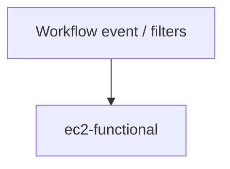
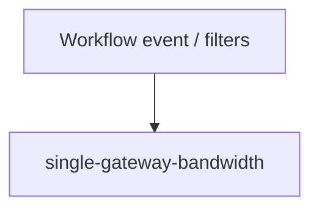
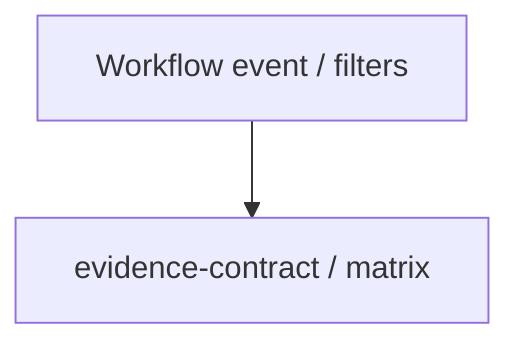
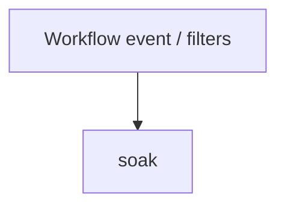
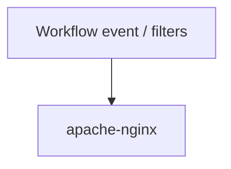
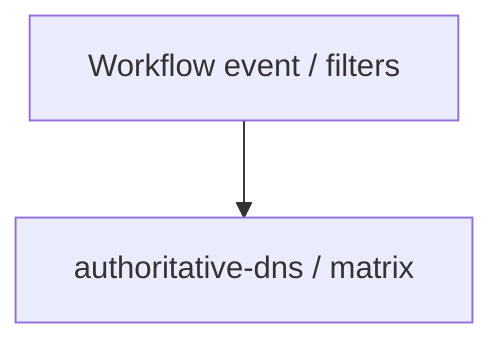
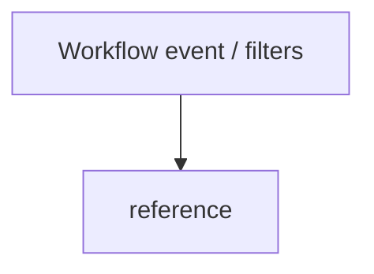
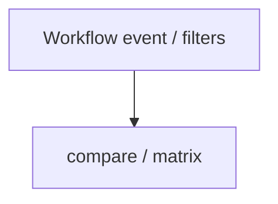
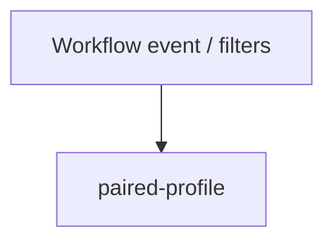
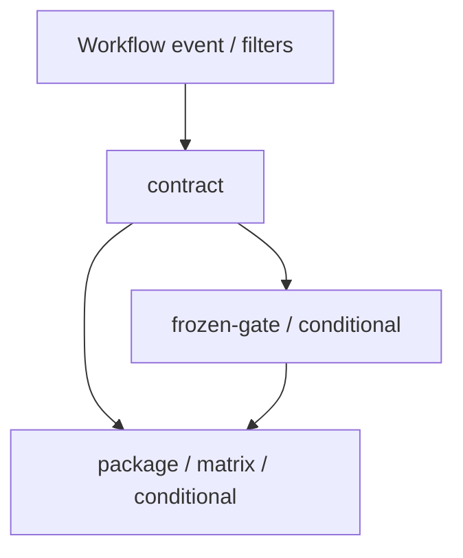

# CI workflow catalog — group 2

[← Catalog index](08-ci-index.md) · [Visual atlas](README.md)

Pinned candidate `6c24dbbab53718102cd96c6380bbe15263a36fe9`. Source-derived job DAG and ordered step summary, not run status. Exact trigger filters, conditions, matrices and commands remain in the YAML.

## ec2-real-control-center.yml

**EC2-backed real Control Center functional checks (read-only)** — `.github/workflows/ec2-real-control-center.yml` (source 6c24dbb)

Events: workflow_dispatch.

- **ec2-functional** — ubuntu-24.04. 1. Use actions/checkout@v4 → 2. Use actions/setup-dotnet@v4 → 3. Check deterministic harness safety contracts (no EC2 traffic) → 4. Gate live EC2 traffic on explicit configured targets → 5. Preflight five direct HTTP requests per EC2 backend → 6. Build real shipping Control Center gateway from this commit → 7. Exercise routing, weights, hashing, ejection, backend TLS and live weight switch → 8. Publish failure context when preflight or test fails → 9. Upload per-request CSV and explicit not-tested evidence

## eod-750mbps-ci-canary.yml

**v0.1 EOD 750 Mbps single-gateway diagnostic (nonproduction)** — `.github/workflows/eod-750mbps-ci-canary.yml` (source 6c24dbb)

Events: pull_request, workflow_dispatch.

- **single-gateway-bandwidth** — ubuntu-24.04. 1. Use actions/checkout@v4 → 2. Fail-closed canary parser unit tests → 3. Check and start isolated real .NET 10 gateway + backend → 4. Verify official oha executable version and immutable pulled digest → 5. Record direct-backend and single-gateway 1 MiB body tests → 6. Attach raw CI evidence and always destroy disposable resources → 7. Use actions/upload-artifact@v4

## exact-main-push-evidence-tests.yml

**Exact main push evidence verifier regression tests** — `.github/workflows/exact-main-push-evidence-tests.yml` (source 6c24dbb)

Events: pull_request, push, workflow_dispatch.

- **evidence-contract** — ${{ matrix.os }} (matrix). 1. Use actions/checkout@v4 → 2. Use actions/setup-python@v5 → 3. Run offline fail-closed acceptance tests → 4. Reject missing required workflow CLI argument

## extended-soak.yml

**Manually requested long-duration k6 soak (non-production)** — `.github/workflows/extended-soak.yml` (source 6c24dbb)

Events: push, workflow_dispatch.

- **soak** — ubuntu-24.04. 1. Use actions/checkout@v4 → 2. Use actions/setup-dotnet@v4 → 3. Build disposable gateway and mock backends → 4. Run soak, sample process working-set and GC collections → 5. Use actions/upload-artifact@v4

## external-origins-e2e.yml

**External HTTP origin integrations - Apache and Nginx** — `.github/workflows/external-origins-e2e.yml` (source 6c24dbb)

Events: pull_request, push, workflow_dispatch.

- **apache-nginx** — ubuntu-24.04. 1. Use actions/checkout@v4 → 2. Use actions/setup-dotnet@v4 → 3. Use actions/setup-python@v5 → 4. Build shipping production-mode Control Center → 5. Pull real Apache and Nginx containers → 6. Run actual HTTP server and ingress-style reverse-proxy chain

## gslb-acceptance.yml

**GSLB authoritative DNS health/failover acceptance** — `.github/workflows/gslb-acceptance.yml` (source 6c24dbb)

Events: push, pull_request, workflow_dispatch.

- **authoritative-dns** — ${{ matrix.os }} (matrix). 1. Use actions/checkout@v4 → 2. Use actions/setup-dotnet@v4 → 3. Use actions/setup-python@v5 → 4. DNS wire probe unit regressions (UDP truncation fallback and header validation) → 5. Run dotnet build → 6. Run dotnet run → 7. Real authoritative DNS UDP/TCP/EDNS/negative-answer wire acceptance → 8. Run dotnet build → 9. Two DNS nodes and two TLS-authenticated external health validators → 10. mTLS signed asynchronous agent reports and replay-safe DNS quorum → 11. Run python tests/GslbAcceptance/ipv6_transport.py → 12. Install independent DNS clients → 13. Validate DNSSEC signatures and denial proofs independently → 14. Query IPv6 authority with BIND and Knot over UDP and TCP

## haproxy-reference-smoke.yml

**HAProxy reference loopback smoke (non-production)** — `.github/workflows/haproxy-reference-smoke.yml` (source 6c24dbb)

Events: pull_request, push, workflow_dispatch.

- **reference** — ubuntu-24.04. 1. Use actions/checkout@v4 → 2. Validate HAProxy config and test real proxy forwarding

## issue24-allocations.yml

**Issue 24 - direct vs proxy allocation comparison** — `.github/workflows/issue24-allocations.yml` (source 6c24dbb)

Events: pull_request, workflow_dispatch.

- **compare** — ubuntu-24.04 (matrix). 1. Use actions/checkout@v4 → 2. Checkout exact comparison revision → 3. Use actions/setup-dotnet@v4 → 4. Verify allocation analyzer contract → 5. Build exact pinned application version → 6. Run sequential matched direct-backend and proxy load → 7. Use actions/upload-artifact@v4

## issue34-paired-profile.yml

**Issue 34 - paired allocation profile** — `.github/workflows/issue34-paired-profile.yml` (source 6c24dbb)

Events: pull_request, workflow_dispatch.

- **paired-profile** — ubuntu-24.04. 1. Checkout candidate revision → 2. Checkout exact PR base (historical baseline for manual runs) → 3. Use actions/setup-dotnet@v4 → 4. Use actions/setup-python@v5 → 5. Install pinned allocation trace tool → 6. Pull pinned k6 runner image before timed samples → 7. Verify deterministic report and instrumentation tests → 8. Apply identical test-only GC pause instrumentation → 9. Build pinned baseline lab → 10. Build candidate lab → 11. Run three alternating before/after pairs and bounded allocation traces → 12. Convert bounded allocation traces to reviewable Speedscope stacks → 13. Run three additional SourceIpHash before/after allocation pairs → 14. Verify complete affinity evidence and reviewable GC stacks → 15. Add paired measurement summary → 16. Use actions/upload-artifact@v4

## issue48-frozen-candidate.yml

**Frozen main issue 48 candidate verification** — `.github/workflows/issue48-frozen-candidate.yml` (source 6c24dbb)

Events: pull_request, push, workflow_dispatch.

- **contract** — ubuntu-24.04. 1. Use actions/checkout@v4 → 2. Run python3 -m
- **frozen-gate** — ubuntu-24.04, conditional. 1. Use actions/checkout@v4 → 2. Verify all required exact-main CI runs → 3. Use actions/upload-artifact@v4
- **package** — ${{ matrix.os }} (matrix), conditional. 1. Use actions/checkout@v4 → 2. Use actions/setup-dotnet@v4 → 3. Publish exact candidate, not a production installer → 4. Archive and verify candidate package → 5. Verify checksum and extract into fresh directory → 6. Actual archived Linux apphost production start, negative keys and restart → 7. Actual archived Windows executable SCM DPAPI restart → 8. Use actions/upload-artifact@v4

