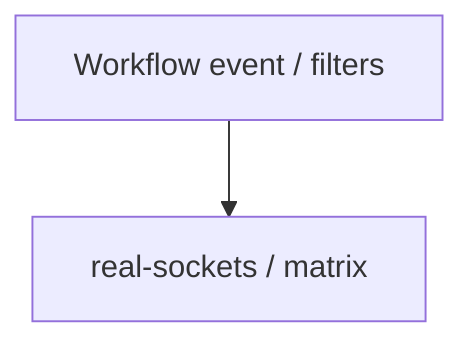
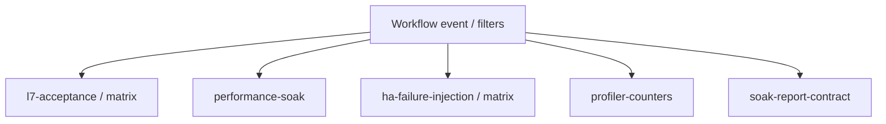
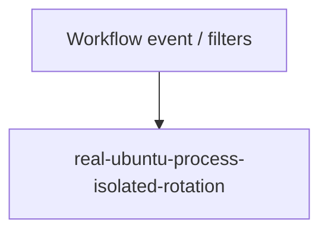
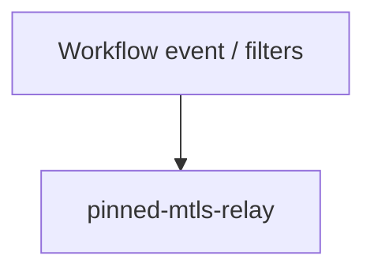
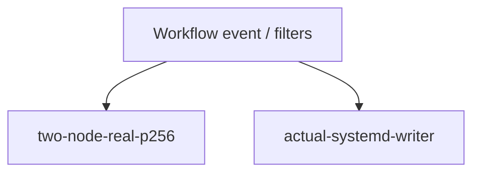
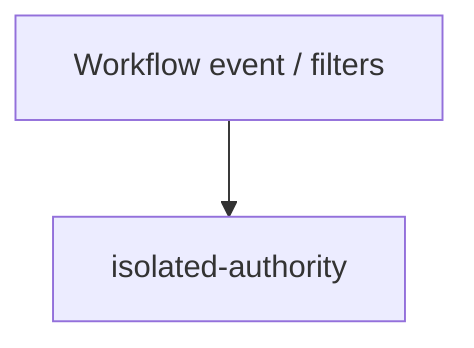
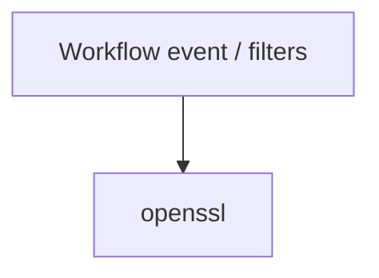
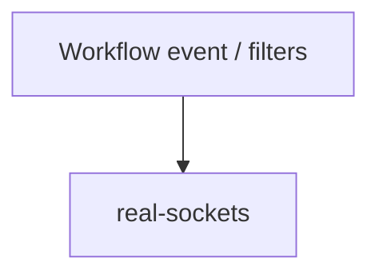
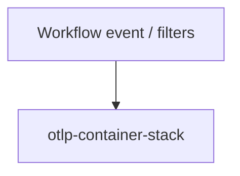
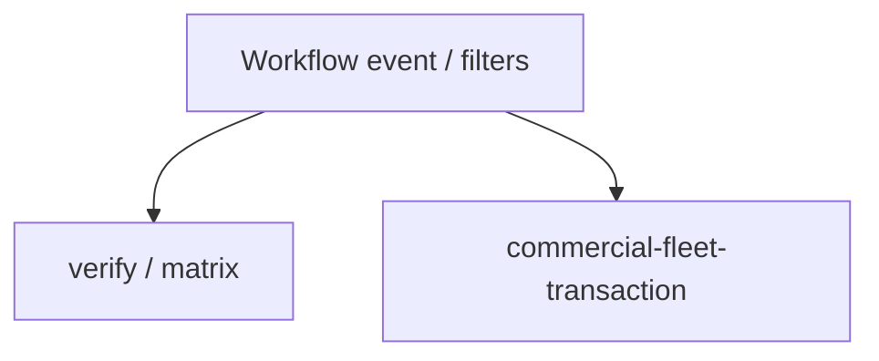

# CI workflow catalog — group 3

[← Catalog index](08-ci-index.md) · [Visual atlas](README.md)

Pinned candidate `6c24dbbab53718102cd96c6380bbe15263a36fe9`. Source-derived job DAG and ordered step summary, not run status. Exact trigger filters, conditions, matrices and commands remain in the YAML.

## l4-acceptance.yml

**L4 experimental engine socket acceptance** — [exact workflow YAML](https://github.com/VY-Groups/yarp-lb/blob/6c24dbbab53718102cd96c6380bbe15263a36fe9/.github/workflows/l4-acceptance.yml)

Events: push, pull_request, workflow_dispatch.

- **real-sockets** — ${{ matrix.os }} (matrix). 1. Use actions/checkout@v4 → 2. Use actions/setup-dotnet@v4 → 3. Build independent L4 engine → 4. Test TCP+UDP real socket forwarding, stickiness, public-bind denial

## l7-acceptance.yml

**YARP 0.1 - L7 build and traffic acceptance** — [exact workflow YAML](https://github.com/VY-Groups/yarp-lb/blob/6c24dbbab53718102cd96c6380bbe15263a36fe9/.github/workflows/l7-acceptance.yml)

Events: push, pull_request, workflow_dispatch.

- **l7-acceptance** — ${{ matrix.os }} (matrix). 1. Checkout sources → 2. Install .NET 10 SDK → 3. Verify SDK version → 4. Build YARP policy gateway → 5. Build test backends → 6. Build integration test runner → 7. Send real requests through YARP and verify failover → 8. Upload PASS/FAIL report and process logs
- **performance-soak** — ubuntu-24.04. 1. Use actions/checkout@v4 → 2. Use actions/setup-dotnet@v4 → 3. Build isolated gateway and backends → 4. Compare direct backends, HTTP proxy and HTTPS proxy with/without keep-alive → 5. Upload benchmark and memory evidence
- **ha-failure-injection** — ${{ matrix.os }} (matrix). 1. Use actions/checkout@v4 → 2. Use actions/setup-dotnet@v4 → 3. Build app backends and YARP gateway → 4. Kill gateway, verify last-known config and health-aware ingress recovery → 5. Analyze 100ms per-process heartbeats even when HA fails → 6. Unit test heartbeat diagnostic summaries → 7. Upload HA failure injection evidence
- **profiler-counters** — ubuntu-24.04. 1. Use actions/checkout@v4 → 2. Use actions/setup-dotnet@v4 → 3. Build L7 test gateway and mock backends → 4. Install official dotnet-counters CLI → 5. Collect System.Runtime, HTTP, TLS, ASP.NET counters under k6 load → 6. Upload diagnostic counter evidence
- **soak-report-contract** — ubuntu-24.04. 1. Use actions/checkout@v4 → 2. Validate five-minute p99 and memory/GC trend reports

## linux-dp-fleet-rolling-dr.yml

**Linux Data Protection two-node rolling certificate and lost-key DR** — [exact workflow YAML](https://github.com/VY-Groups/yarp-lb/blob/6c24dbbab53718102cd96c6380bbe15263a36fe9/.github/workflows/linux-dp-fleet-rolling-dr.yml)

Events: pull_request, push, workflow_dispatch.

- **real-ubuntu-process-isolated-rotation** — ubuntu-24.04. 1. Use actions/checkout@v4 → 2. Use actions/setup-dotnet@v4 → 3. Build shipping GatewayCore for live proxy cutover → 4. Real two-process RSA key-ring rolling migration and fail-closed DR

## linux-dp-mtls-transfer.yml

**Offline Linux DP pinned mTLS transfer acceptance** — [exact workflow YAML](https://github.com/VY-Groups/yarp-lb/blob/6c24dbbab53718102cd96c6380bbe15263a36fe9/.github/workflows/linux-dp-mtls-transfer.yml)

Events: push, pull_request, workflow_dispatch.

- **pinned-mtls-relay** — ubuntu-24.04. 1. Use actions/checkout@v4 → 2. Verify real OpenSSL identities and stdlib mutual TLS transport → 3. Reject unauthorized external Python dependencies and compile source

## linux-dp-quiescence.yml

**Signed Linux DP dual-node writer quiescence acceptance** — [exact workflow YAML](https://github.com/VY-Groups/yarp-lb/blob/6c24dbbab53718102cd96c6380bbe15263a36fe9/.github/workflows/linux-dp-quiescence.yml)

Events: pull_request, push, workflow_dispatch.

- **two-node-real-p256** — ubuntu-24.04. 1. Use actions/checkout@v4 → 2. Verify real P-256 signatures, source/destination identity and replay
- **actual-systemd-writer** — ubuntu-24.04. 1. Use actions/checkout@v4 → 2. Stop and runtime-mask disposable actual systemd writer

## linux-dp-quorum-authority.yml

**Linux DP independent recovery quorum contracts** — [exact workflow YAML](https://github.com/VY-Groups/yarp-lb/blob/6c24dbbab53718102cd96c6380bbe15263a36fe9/.github/workflows/linux-dp-quorum-authority.yml)

Events: push, pull_request, workflow_dispatch.

- **isolated-authority** — ubuntu-24.04. 1. Use actions/checkout@v4 → 2. Validate strict signed-recovery lease identity and 2-of-3 CAS

## linux-dp-wrap-delivery.yml

**Linux DP node-bound wrapping-key delivery** — [exact workflow YAML](https://github.com/VY-Groups/yarp-lb/blob/6c24dbbab53718102cd96c6380bbe15263a36fe9/.github/workflows/linux-dp-wrap-delivery.yml)

Events: push, pull_request, workflow_dispatch.

- **openssl** — ubuntu-24.04. 1. Use actions/checkout@v4 → 2. Real OpenSSL recipient-specific authenticated delivery

## listener-isolation.yml

**v0.1 real-socket listener isolation and actual metrics** — [exact workflow YAML](https://github.com/VY-Groups/yarp-lb/blob/6c24dbbab53718102cd96c6380bbe15263a36fe9/.github/workflows/listener-isolation.yml)

Events: pull_request, workflow_dispatch.

- **real-sockets** — ubuntu-24.04. 1. Use actions/checkout@v4 → 2. Use actions/setup-dotnet@v4 → 3. Build actual shipping gateway → 4. Exercise 4 real sockets with mTLS and wildcard rejection → 5. Diff real exported metric families against contract and alert/dashboard expressions → 6. Diff the real /gateway/metrics response against metric contract, alerts and dashboard → 7. Validate measured client concurrency and actual systemd NOFILE drop-in → 8. Use actions/upload-artifact@v4

## observability-container-acceptance.yml

**OTLP Collector, Prometheus and Grafana container acceptance** — [exact workflow YAML](https://github.com/VY-Groups/yarp-lb/blob/6c24dbbab53718102cd96c6380bbe15263a36fe9/.github/workflows/observability-container-acceptance.yml)

Events: pull_request, push.

- **otlp-container-stack** — ubuntu-24.04. 1. Use actions/checkout@v4 → 2. Use actions/setup-dotnet@v4 → 3. Test fail-closed per-gateway site audit metric acceptance → 4. Validate dashboard and container configuration → 5. Validate real Prometheus alert semantics, including Collector loss signals → 6. Start isolated observability stack → 7. Export real spans, metrics and sanitized access summaries to Collector, then verify Prometheus and Grafana → 8. Upload Collector evidence

## offline-licensing-development.yml

**Offline commercial license verifier (development)** — [exact workflow YAML](https://github.com/VY-Groups/yarp-lb/blob/6c24dbbab53718102cd96c6380bbe15263a36fe9/.github/workflows/offline-licensing-development.yml)

Events: push, pull_request.

- **verify** — ${{ matrix.os }} (matrix). 1. Use actions/checkout@v4 → 2. Use actions/setup-dotnet@v4 → 3. Use actions/setup-python@v5 → 4. Run dotnet run → 5. Compile commercial gateway against disposable public trust → 6. Actual commercial gateway activation with no network except loopback → 7. Published commercial package startup integrity → 8. Commercial independent engine feature acceptance → 9. Remove disposable signing fixture
- **commercial-fleet-transaction** — ubuntu-24.04. 1. Use actions/checkout@v4 → 2. Use actions/setup-dotnet@v4 → 3. Build isolated commercial and ordinary test executables → 4. Real licensed controller and two agents with production CRL validation, rollout and revoked recovery → 5. Remove disposable signing material

