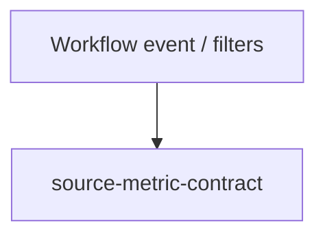
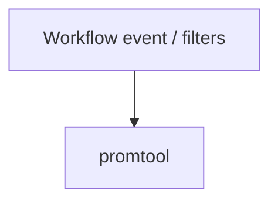
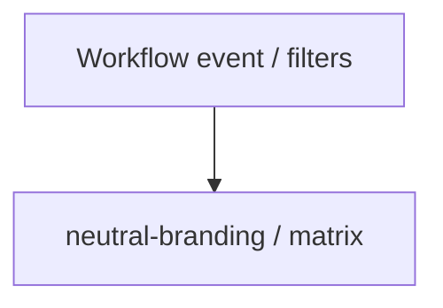
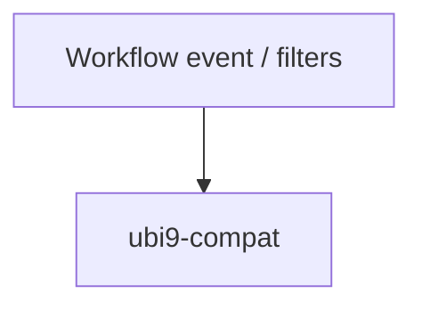
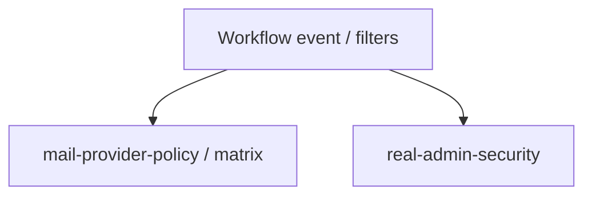
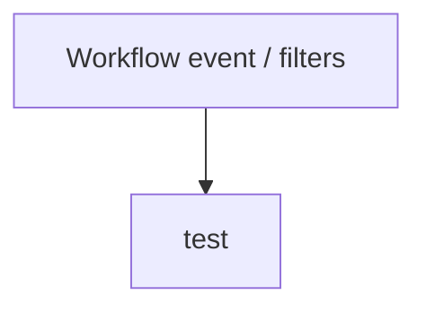
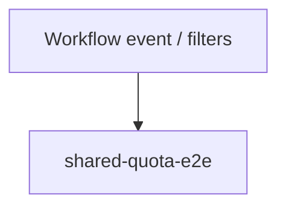
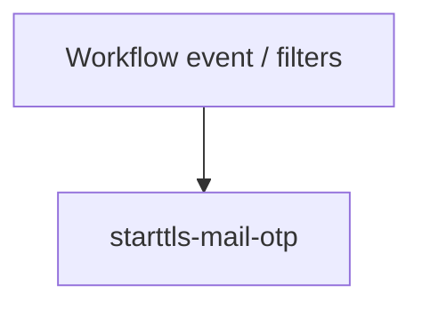
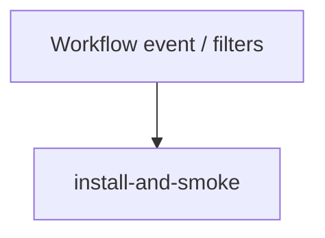
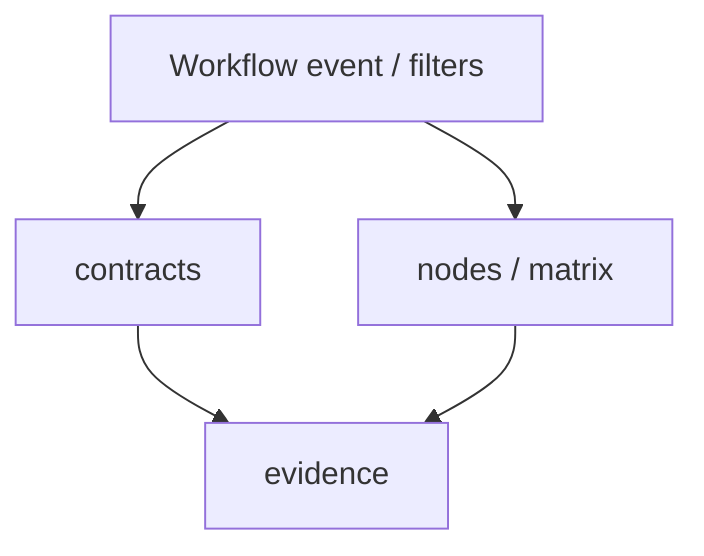

# CI workflow catalog — group 4

[← Catalog index](08-ci-index.md) · [Visual atlas](README.md)

Pinned candidate `6c24dbbab53718102cd96c6380bbe15263a36fe9`. Source-derived job DAG and ordered step summary, not run status. Exact trigger filters, conditions, matrices and commands remain in the YAML.

## onprem-ops-contract.yml

**On-prem operations source contract** — `.github/workflows/onprem-ops-contract.yml` (source 6c24dbb)

Events: push, pull_request, workflow_dispatch.

- **source-metric-contract** — ubuntu-24.04. 1. Use actions/checkout@v4 → 2. Check source metric names, loopback scope and external TLS dependency

## onprem-promtool.yml

**On-prem Prometheus rules contract (synthetic CI)** — `.github/workflows/onprem-promtool.yml` (source 6c24dbb)

Events: push, pull_request, workflow_dispatch.

- **promtool** — ubuntu-24.04. 1. Use actions/checkout@v4 → 2. Validate production alert rule syntax (Prometheus promtool) → 3. Evaluate outage/health/expiry/drop synthetic alert fixtures

## repository-branding.yml

**Repository-neutral branding (source and docs)** — `.github/workflows/repository-branding.yml` (source 6c24dbb)

Events: push, pull_request, workflow_dispatch.

- **neutral-branding** — ${{ matrix.os }} (matrix). 1. Use actions/checkout@v4 → 2. Use actions/setup-python@v5 → 3. Reject organization-specific names in tracked paths and text

## rhel-ubi9-dp-compat.yml

**RHEL-family UBI9 .NET 10 Data Protection compatibility** — `.github/workflows/rhel-ubi9-dp-compat.yml` (source 6c24dbb)

Events: push, pull_request, workflow_dispatch.

- **ubi9-compat** — ubuntu-24.04. 1. Use actions/checkout@v4 → 2. Use actions/setup-dotnet@v4 → 3. Build shipping Control Center for real RHEL-family startup smoke → 4. Compile offline encrypted snapshot CLI before runtime acceptance → 5. Run real encrypted key-ring and signed restore tests in UBI9 .NET 10 SDK

## security-acceptance.yml

**Security acceptance - mail providers and administrator workflows** — `.github/workflows/security-acceptance.yml` (source 6c24dbb)

Events: pull_request, push, workflow_dispatch.

- **mail-provider-policy** — ${{ matrix.os }} (matrix). 1. Use actions/checkout@v4 → 2. Use actions/setup-dotnet@v4 → 3. Run isolated Google/Microsoft OAuth2 host and token security tests → 4. Build actual shipping Control Center → 5. Use actions/setup-node@v4 → 6. Test unauthorized sessions and role denials in browser logic
- **real-admin-security** — ubuntu-24.04. 1. Use actions/checkout@v4 → 2. Use actions/setup-dotnet@v4 → 3. Use actions/setup-python@v5 → 4. Build production-mode application → 5. Exercise real authenticated administrative HTTP API and security gates → 6. Install disposable Redis authority for shared OIDC acceptance → 7. Exercise real HTTPS OIDC callback and negative token cases

## shared-quota-redis.yml

**Experimental shared rate quota - Redis atomicity and source build** — `.github/workflows/shared-quota-redis.yml` (source 6c24dbb)

Events: pull_request, workflow_dispatch.

- **test** — ubuntu-24.04. 1. Use actions/checkout@v4 → 2. Use actions/setup-dotnet@v4 → 3. Verify shipping application compiles → 4. Run disposable Redis with explicit loopback-only binding → 5. Concurrent atomic quota tests against real Redis Lua → 6. Shut down disposable Redis

## shared-quota-two-nodes.yml

**Two real GatewayCore nodes - shared TLS Redis quota and partition** — `.github/workflows/shared-quota-two-nodes.yml` (source 6c24dbb)

Events: pull_request, workflow_dispatch.

- **shared-quota-e2e** — ubuntu-24.04. 1. Use actions/checkout@v4 → 2. Generate disposable CA, signed Redis TLS identity and authentication → 3. Build test-only real GatewayCore image and trusted-Redis extension → 4. Start two gateway instances with authenticated TLS Redis → 5. Exercise combined quota against both shipping gateway processes → 6. Simulate loss of the only Redis writer (no local quota fallback) → 7. Collect fault logs; dispose test containers, CA and secrets

## smtp-starttls-e2e.yml

**Real SMTP STARTTLS and OTP integration (isolated CI)** — `.github/workflows/smtp-starttls-e2e.yml` (source 6c24dbb)

Events: pull_request, push, workflow_dispatch.

- **starttls-mail-otp** — ubuntu-24.04. 1. Use actions/checkout@v4 → 2. Use actions/setup-dotnet@v4 → 3. Use actions/setup-python@v5 → 4. Build shipping Control Center → 5. Install pinned isolated SMTP test fixture → 6. Exercise real authenticated TLS SMTP and complete OTP login

## test-server-install-smoke.yml

**GatewayCore test-server installer smoke** — `.github/workflows/test-server-install-smoke.yml` (source 6c24dbb)

Events: pull_request, workflow_dispatch.

- **install-and-smoke** — ubuntu-24.04. 1. Use actions/checkout@v4 → 2. Validate shell scripts and Docker Compose → 3. Install actual GatewayCore lab stack from source → 4. Verify HTTP and trusted ECDSA HTTPS and restricted paths → 5. Collect logs and current SHA → 6. Use actions/upload-artifact@v4 → 7. Remove disposable services

## two-ubuntu-gateway-load.yml

**Two independent Ubuntu VMs - GatewayCore synthetic website and body-throughput** — `.github/workflows/two-ubuntu-gateway-load.yml` (source 6c24dbb)

Events: pull_request, workflow_dispatch.

- **contracts** — ubuntu-24.04. 1. Use actions/checkout@v4 → 2. Verify evidence contracts
- **nodes** — ubuntu-24.04 (matrix). 1. Use actions/checkout@v4 → 2. Build actual GatewayCore and disposable HTTP backend website stack → 3. Verify website and gateway forwarding on this VM → 4. Measure per-minute HTTP body throughput and p99 → 5. Capture logs and exact commit → 6. Use actions/upload-artifact@v4 → 7. Destroy disposable services
- **evidence** — ubuntu-24.04. 1. Use actions/checkout@v4 → 2. Use actions/download-artifact@v4 → 3. Reject missing, duplicate or failed host evidence → 4. Use actions/upload-artifact@v4

