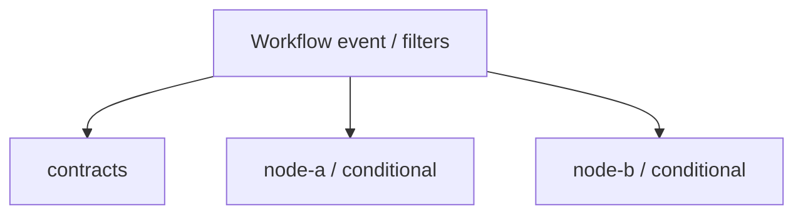
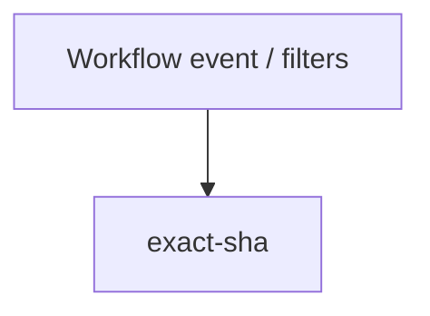
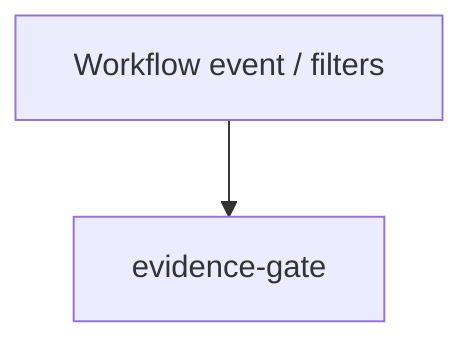
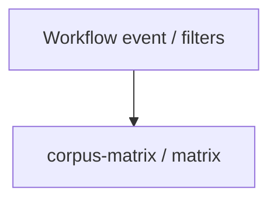
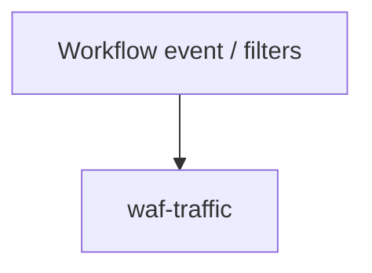
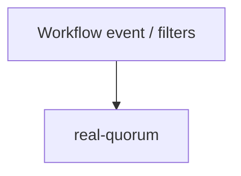
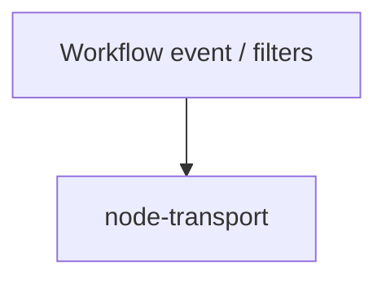
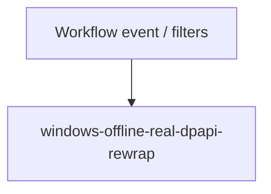
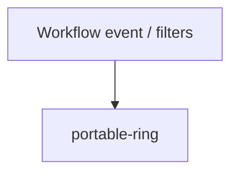
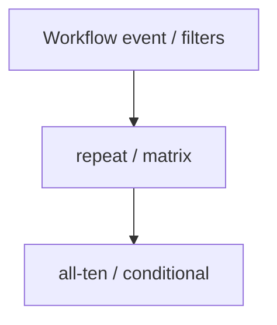

# CI workflow catalog — group 5

[← Catalog index](08-ci-index.md) · [Visual atlas](README.md)

Pinned candidate `6c24dbbab53718102cd96c6380bbe15263a36fe9`. Source-derived job DAG and ordered step summary, not run status. Exact trigger filters, conditions, matrices and commands remain in the YAML.

## two-ubuntu-tailnet-failover.yml

**Manual two-host Ubuntu failover over encrypted Tailscale overlay** — [exact workflow YAML](https://github.com/VY-Groups/yarp-lb/blob/6c24dbbab53718102cd96c6380bbe15263a36fe9/.github/workflows/two-ubuntu-tailnet-failover.yml)

Events: pull_request, workflow_dispatch.

- **contracts** — ubuntu-24.04. 1. Use actions/checkout@v4 → 2. Validate scripts without accessing a Tailnet
- **node-a** — ubuntu-24.04, conditional. 1. Use actions/checkout@v4 → 2. Join ephemeral private tailnet with scoped CI tag → 3. Capture private-only tailnet listener address → 4. Run real GatewayCore and website origins on Ubuntu VM A → 5. Publish only endpoint IP and exact source SHA for this run → 6. Use actions/upload-artifact@v4 → 7. Await peer-triggered gateway fault → 8. Kill only disposable Ubuntu A gateway container → 9. Acknowledge fault through same-run artifacts → 10. Use actions/upload-artifact@v4 → 11. Await request for recovering Ubuntu A gateway → 12. Restart same gateway and verify its health → 13. Acknowledge gateway A recovery → 14. Use actions/upload-artifact@v4 → 15. Await completion of remote ingress verification → 16. Teardown runner A
- **node-b** — ubuntu-24.04, conditional. 1. Use actions/checkout@v4 → 2. Join same restricted ephemeral tailnet → 3. Capture private-only listener address → 4. Run real GatewayCore and website origins on independent Ubuntu B VM → 5. Discover A from current-run artifact, never a public IP → 6. Install isolated HAProxy ingress and verify BOTH VM gateways before failure → 7. Request remote A SIGKILL with same-run artifact → 8. Use actions/upload-artifact@v4 → 9. Await confirmed A failure → 10. Measure absolute failures and steady-state recovery through real ingress → 11. Request remote A process restart → 12. Use actions/upload-artifact@v4 → 13. Await A restart and confirm ingress availability → 14. Signal completion so A can terminate safely → 15. Use actions/upload-artifact@v4 → 16. Use actions/upload-artifact@v4 → 17. Teardown runner B

## v01-release-evidence.yml

**v0.1 exact-commit release evidence (CI only)** — [exact workflow YAML](https://github.com/VY-Groups/yarp-lb/blob/6c24dbbab53718102cd96c6380bbe15263a36fe9/.github/workflows/v01-release-evidence.yml)

Events: pull_request, workflow_dispatch.

- **exact-sha** — ubuntu-24.04. 1. Use actions/checkout@v4 → 2. Validate release verdict with synthetic negative tests → 3. Compare all required GitHub Actions against exact dispatched SHA → 4. Upload GO/NO-GO evidence (never deploy)

## waf-corpus-evidence.yml

**WAF operator corpus evidence policy contract** — [exact workflow YAML](https://github.com/VY-Groups/yarp-lb/blob/6c24dbbab53718102cd96c6380bbe15263a36fe9/.github/workflows/waf-corpus-evidence.yml)

Events: push, pull_request, workflow_dispatch.

- **evidence-gate** — ubuntu-24.04. 1. Use actions/checkout@v4 → 2. Use actions/setup-python@v5 → 3. Require OpenSSL P-256 verifier on disposable CI runner → 4. Reject malformed or ambiguous WAF policy and corpus evidence

## waf-corpus-matrix.yml

**WAF corpus matrix acceptance** — [exact workflow YAML](https://github.com/VY-Groups/yarp-lb/blob/6c24dbbab53718102cd96c6380bbe15263a36fe9/.github/workflows/waf-corpus-matrix.yml)

Events: pull_request, workflow_dispatch.

- **corpus-matrix** — ${{ matrix.os }} (matrix). 1. Use actions/checkout@v4 → 2. Use actions/setup-python@v5 → 3. Run redacted WAF corpus matrix regression tests

## waf-crs-acceptance.yml

**ModSecurity OWASP CRS external WAF acceptance** — [exact workflow YAML](https://github.com/VY-Groups/yarp-lb/blob/6c24dbbab53718102cd96c6380bbe15263a36fe9/.github/workflows/waf-crs-acceptance.yml)

Events: push, pull_request, workflow_dispatch.

- **waf-traffic** — ubuntu-24.04. 1. Use actions/checkout@v4 → 2. Verify offline WAF matrix report privacy and corpus contracts → 3. Run OWASP CRS and real HTTP allow/block checks in isolated Docker network → 4. Exercise two isolated WAF containers with signed transaction and failure compensation → 5. Upload allowlisted synthetic WAF evidence (no raw logs or private corpus)

## waf-etcd-quorum.yml

**Live three-member etcd quorum fencing CI** — [exact workflow YAML](https://github.com/VY-Groups/yarp-lb/blob/6c24dbbab53718102cd96c6380bbe15263a36fe9/.github/workflows/waf-etcd-quorum.yml)

Events: push, pull_request, workflow_dispatch.

- **real-quorum** — ubuntu-24.04. 1. Use actions/checkout@v4 → 2. Use actions/setup-dotnet@v4 → 3. Build actual distributed Data Protection acceptance executable → 4. Resolve immutable upstream etcd release image → 5. Run disposable real mTLS etcd consensus and failure acceptance → 6. Verify pinned remote node TLS and independently fenced two-node compensation → 7. Validate independently signed Linux DP quorum and CAS contracts → 8. Validate independent CAS authority conflict/revocation contracts → 9. Repeat synthetic fail-closed quorum client contracts

## waf-mtls-node.yml

**Authenticated remote WAF node fencing acceptance** — [exact workflow YAML](https://github.com/VY-Groups/yarp-lb/blob/6c24dbbab53718102cd96c6380bbe15263a36fe9/.github/workflows/waf-mtls-node.yml)

Events: push, pull_request, workflow_dispatch.

- **node-transport** — ubuntu-24.04. 1. Use actions/checkout@v4 → 2. Verify pinned mutual-TLS node mutation and two-node rollback

## windows-dpapi-fleet-migration.yml

**Real Windows DPAPI to fleet certificate migration** — [exact workflow YAML](https://github.com/VY-Groups/yarp-lb/blob/6c24dbbab53718102cd96c6380bbe15263a36fe9/.github/workflows/windows-dpapi-fleet-migration.yml)

Events: pull_request, push, workflow_dispatch.

- **windows-offline-real-dpapi-rewrap** — windows-2022. 1. Use actions/checkout@v4 → 2. Use actions/setup-dotnet@v4 → 3. Publish independently invoked .NET 10 Windows migration executable → 4. Real DPAPI LocalMachine to X509 rewrap and old-cookie continuity

## windows-fleet-dp.yml

**Windows Data Protection shared fleet certificate acceptance** — [exact workflow YAML](https://github.com/VY-Groups/yarp-lb/blob/6c24dbbab53718102cd96c6380bbe15263a36fe9/.github/workflows/windows-fleet-dp.yml)

Events: push, pull_request, workflow_dispatch.

- **portable-ring** — windows-2022. 1. Use actions/checkout@v4 → 2. Use actions/setup-dotnet@v4 → 3. Real disposable Windows machine certificate store and two-state test

## windows-ha-10x.yml

**Windows HA 10-run stability gate** — [exact workflow YAML](https://github.com/VY-Groups/yarp-lb/blob/6c24dbbab53718102cd96c6380bbe15263a36fe9/.github/workflows/windows-ha-10x.yml)

Events: pull_request, workflow_dispatch.

- **repeat** — windows-2022 (matrix). 1. Use actions/checkout@v4 → 2. Use actions/setup-dotnet@v4 → 3. Build real two-gateway HA fault-injection rig → 4. Execute Windows kill/drain/no-replay/failclosed/panic acceptance - repeat ${{ matrix.repeat }} → 5. Summarize 100ms heartbeats and pre-kill requests on all outcomes → 6. Verify heartbeat analysis contract → 7. Retain full per-run pass/fail evidence and fault timeline
- **all-ten** — ubuntu-24.04, conditional. 1. Use actions/checkout@v4 → 2. Verify evidence validator rejects fabricated or missing runs → 3. Download all ten per-run raw artifacts from THIS workflow run → 4. Report actual worst failure window; fail on missing or red run → 5. Upload strict ten-run aggregate for incident review

