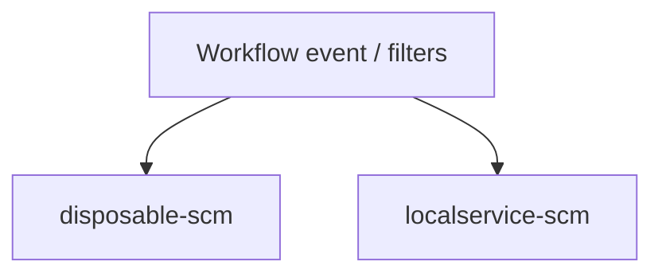
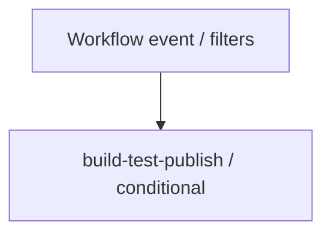
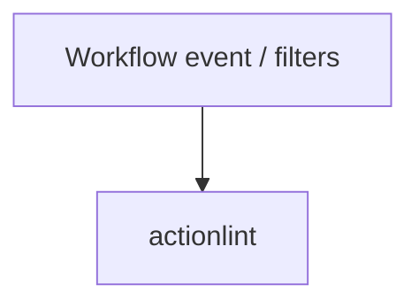

# CI workflow catalog — group 6

[← Catalog index](08-ci-index.md) · [Visual atlas](README.md)

Pinned candidate `6c24dbbab53718102cd96c6380bbe15263a36fe9`. Source-derived job DAG and ordered step summary, not run status. Exact trigger filters, conditions, matrices and commands remain in the YAML.

## windows-scm-acceptance.yml

**Windows SCM Data Protection restart acceptance** — `.github/workflows/windows-scm-acceptance.yml` (source 6c24dbb)

Events: push, pull_request, workflow_dispatch.

- **disposable-scm** — windows-2022. 1. Use actions/checkout@v4 → 2. Use actions/setup-dotnet@v4 → 3. Parse PowerShell SCM acceptance script → 4. Real disposable SCM process and DPAPI protected session restart
- **localservice-scm** — windows-2022. 1. Use actions/checkout@v4 → 2. Use actions/setup-dotnet@v4 → 3. Parse restricted Windows SCM acceptance script → 4. Actual disposable LocalService state ACL and DPAPI cookie restart

## windows-test-release.yml

**Windows x64 HTTP origin test pre-release** — `.github/workflows/windows-test-release.yml` (source 6c24dbb)

Events: pull_request, workflow_dispatch.

- **build-test-publish** — windows-2022, conditional. 1. Use actions/checkout@v4 → 2. Use actions/setup-dotnet@v4 → 3. Validate launcher parses → 4. Verify UI TypeScript build and onboarding regression tests → 5. Verify Windows legacy state is rejected before bootstrap → 6. Verify Google/Microsoft SMTP OAuth and security policy → 7. Build self-contained Windows x64 release → 8. Real executable - local IIS-like backend and gateway proxy smoke → 9. Compress tested release payload and calculate SHA256 → 10. Publish GitHub test pre-release (never production) → 11. Keep build evidence if release step fails

## workflow-lint.yml

**v0.1 GitHub Actions definitions lint** — `.github/workflows/workflow-lint.yml` (source 6c24dbb)

Events: pull_request, workflow_dispatch.

- **actionlint** — ubuntu-24.04. 1. Use actions/checkout@v4 → 2. Validate every workflow definition and embedded shell

