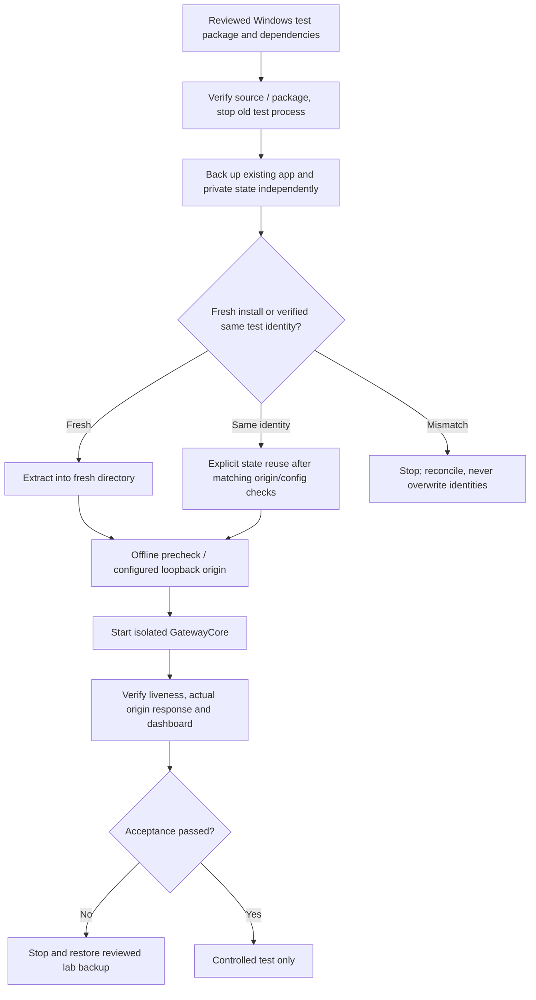
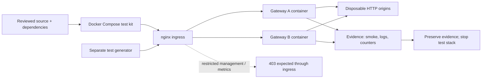
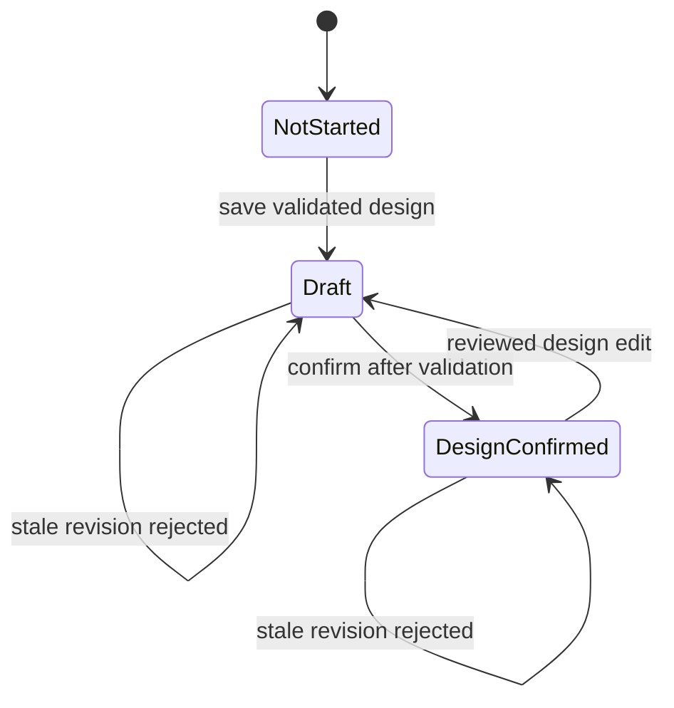
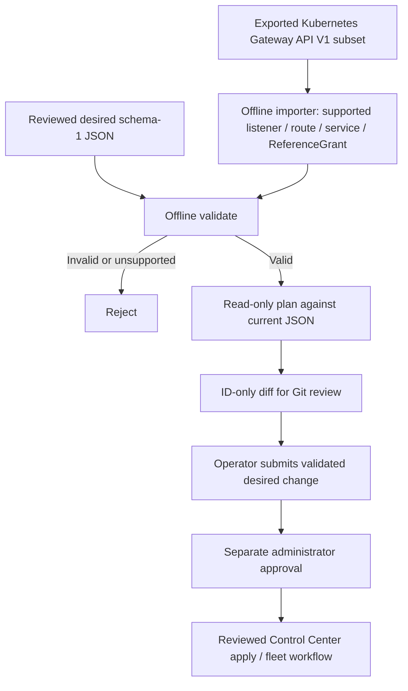

# 09 — Installation, onboarding and configuration as code

[← Visual atlas](README.md)

Source snapshot: `6c24dbbab53718102cd96c6380bbe15263a36fe9`. These are controlled testing and operator workflows, not automatic production deployment.

## Windows offline installation / test upgrade

The Windows test package is distinct from the commercial signed package. Existing state is not automatically overwritten. Health 200 is liveness, not upstream readiness. No firewall, IIS or database modification is implied.

**Source:** [ops/windows-test/README.md](https://github.com/VY-Groups/yarp-lb/blob/6c24dbbab53718102cd96c6380bbe15263a36fe9/ops/windows-test/README.md) · [control-center/docs/SETUP_CHECKLIST.md](https://github.com/VY-Groups/yarp-lb/blob/6c24dbbab53718102cd96c6380bbe15263a36fe9/control-center/docs/SETUP_CHECKLIST.md)

## Ubuntu disposable Docker laboratory

One Docker host is not two physical HA hosts. Use a separate load generator for capacity evidence and retain raw results.

**Source:** [ops/test-server/README.md](https://github.com/VY-Groups/yarp-lb/blob/6c24dbbab53718102cd96c6380bbe15263a36fe9/ops/test-server/README.md)

## Architecture onboarding

This state machine deliberately has no deployed state. Onboarding validates and stores metadata; actual routing changes use reviewed changes.

**Source:** [control-center/Onboarding.cs](https://github.com/VY-Groups/yarp-lb/blob/6c24dbbab53718102cd96c6380bbe15263a36fe9/control-center/Onboarding.cs) · [control-center/docs/ARCHITECTURE.md](https://github.com/VY-Groups/yarp-lb/blob/6c24dbbab53718102cd96c6380bbe15263a36fe9/control-center/docs/ARCHITECTURE.md)

## Offline GitOps-style planning and Gateway API import

The tool has no cluster lookup, watch, live reconciliation, Terraform provider, full Kubernetes controller, or automatic revocation of a changed ReferenceGrant. Import output contains addresses and requires protected storage. Plan/validate output is redacted. Unsupported configuration semantics must be rejected, not silently stripped.

**Source:** [control-center/tools/GatewayConfigPlan/README.md](https://github.com/VY-Groups/yarp-lb/blob/6c24dbbab53718102cd96c6380bbe15263a36fe9/control-center/tools/GatewayConfigPlan/README.md) · [control-center/tools/GatewayConfigPlan/PlanEngine.cs](https://github.com/VY-Groups/yarp-lb/blob/6c24dbbab53718102cd96c6380bbe15263a36fe9/control-center/tools/GatewayConfigPlan/PlanEngine.cs) · [control-center/tools/GatewayConfigPlan/GatewayApiImport.cs](https://github.com/VY-Groups/yarp-lb/blob/6c24dbbab53718102cd96c6380bbe15263a36fe9/control-center/tools/GatewayConfigPlan/GatewayApiImport.cs)

