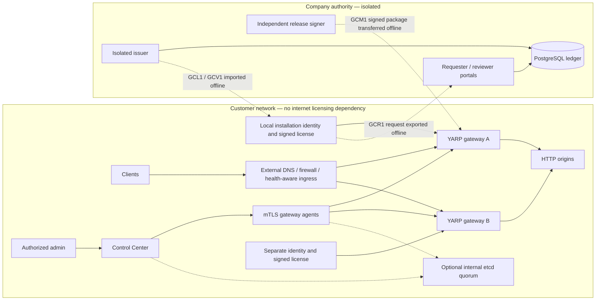

# GatewayCore visual architecture atlas

Start here to understand the product, its trust boundaries and its engineering workflows. GitHub renders the Mermaid diagrams directly; expand a page to inspect the flow. All diagrams remain editable Markdown source.

## Status and revision legend

- **Main**: documentation branch based on customer main `20e465054cd30704ae163f89ed578c8e9c4862d8`.
- **Candidate**: customer licensing/fleet stack through PR #549, snapshot `6c24dbb` (repository revision/path: `6c24dbbab53718102cd96c6380bbe15263a36fe9`). Commercial behavior described here is candidate behavior, not an assertion of merge or exact-head CI success.
- **Opt-in**: separate configuration, credentials and external services are required.
- **External / physical**: operator-owned network, PKI, production systems or actual-host acceptance. Software diagrams never constitute production signoff.

## Reading order

| Page | What it explains |
|---|---|
| [01 — System & deployment](01-system.md) | Context, data/control planes, standalone/HA/fleet, network zones, external dependencies |
| [02 — Traffic & engines](02-traffic.md) | L7 HTTP, health, capacity, L4 TCP/UDP, DNS/GSLB, WAF and shared quota |
| [03 — Control Center & security](03-management.md) | Authentication, privacy, RBAC, reviewed config, audit, TLS/ACME, observability |
| [04 — Offline licensing](04-licensing.md) | Repository boundary, activation, validation, renewal/revocation, runtime states, package integrity |
| [05 — Distributed controller fencing](05-fencing.md) | etcd ownership, fresh peer proofs, monotonic epochs, competing controllers, partition and crash recovery |
| [06 — HA, DR & key protection](06-recovery.md) | Active-active routing, site failover, backup/restore, Windows/Linux key protection |
| [07 — Build, test & release](07-delivery.md) | PR dependency chain, exact-head CI, release and physical acceptance |
| [08 — CI workflow catalog](08-ci-index.md) | Individual workflow job graphs generated from pinned YAML |
| [09 — Installation and config-as-code](09-installation.md) | Windows/Linux testing, onboarding, offline GitOps planning and Kubernetes import |
| Company authority atlas — `gatewaycore-license-authority:docs/diagrams/README.md` | Issuance, billing, approval, PostgreSQL, recovery and independent signing |

## One picture of the whole system

Arrows crossing the company/customer boundary represent **operator-mediated file transfer**, not a runtime network call. Internal etcd is a separately deployed control-plane dependency only for the corresponding opt-in/candidate workflows; it is not a license heartbeat.

Maintain this atlas with the code. Update the pinned source links, status, workflow catalog and diagrams when implementation changes. Never use it as evidence that an untested feature is production-ready.
